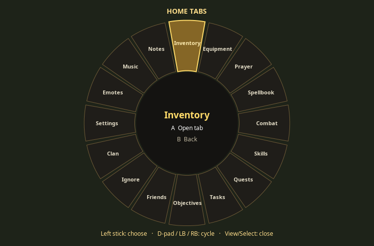

# SoloScape 2011+

A local, single-player-first RuneScape revision-634 project, exploring native
controller play and a console-style experience for Steam Deck. Built as a tracked
patch layer over the pinned 2011Scape/Void server and RuneLite-style client.

**Stage: playable console alpha on `main`.** Local gameplay works and the owner
has confirmed camera, movement feedback and optional direct movement feel good.
Installer and code-only update releases are available. Steam Deck performance, full interface coverage,
upstream content completeness and physical interface play still need acceptance. Isolated native save/reload and a gathering–production–combat route are verified.

This is a public, **maintainer-directed** development repository. Feedback and small,
agreed contributions are welcome. Scope and merges remain with the maintainer;
please discuss larger changes before starting. See [contributing](CONTRIBUTING.md).

## What works today

- Native SDL2 controller input, camera panning and configurable deadzones/speeds.
- Camera-relative destination walking, plus a reversible direct movement toggle
  using authoritative server steps, normal collision and run-energy rules.
- Ground movement feedback, target highlights, LT aim, LB/RB target cycling.
- A interactions, X native action menus, ground loot targeting and B cancellation.
- Inventory focus and dialogue navigation with native widget validation.
- A **16-slot home-tab radial proof of concept**: View/Select opens; left stick
  highlights; A opens the tab; B cancels. D-pad/LB/RB can cycle. Settings, spellbook,
  inventory, equipment and the other main slots share one wheel. Unavailable tabs
  are dimmed. Inventory, Equipment, Prayer and Spellbook now hand off to controller focus; Combat, Skills, Quests and supported Settings now also hand off; remaining tabs keep native mouse controls.
- Bank, deposit-box and shop panes, native quantities/actions, scrolling and tabs.
- A controller keyboard for quantities, names, text and native bank search.
- Equipment/prayer/spell focus and native item/spell targeting with explicit cancel.
- A separate eight-slot quick-action wheel for explicitly assigned food, potions, prayers and spells.
- Production amount presets, smithing/tanning/jewellery navigation, scaled controller overlays, Xbox/PlayStation labels and configurable menu buttons.
- Reversible custom inventory/equipment/bank/shop screens backed by native actions.
- Eight action bindings, conflict checks, Xbox/PlayStation/Deck presets and run thresholds.
- Graphical New/Continue launcher, controller character naming, isolated worlds, verified backups and owned-session recovery.
- Optional custom quest journal, skills, combat, prayer and spellbook screens with native state/details.
- Controller preferences/first-run setup from Home Settings, special-attack quick binding and source/target return.
- Session capability negotiation, interruption guards and reproducible client/server patches.



*Renderer preview at 765×503; this is not an in-game screenshot. Physical radial
acceptance remains pending.*

## Get started

### First-time install (no building by hand)

For Linux x86_64 with a graphical session, including a Steam Deck in Desktop Mode. You do not need Python, git or Java installed: the installer brings its own pinned copies into one folder, with no root access.

1. **Download the installer**, `soloscape-installer.sh`, from the [latest release](https://github.com/kannibalk1w1/SoloScape/releases/latest).
2. **Download the game cache yourself.** It is not included and the installer never downloads it, like a recompiled game needing a copy of the original. Get `2026-08-02-void-634-cache.7z` from the folder the 2011Scape/Void maintainers link: [MEGA folder](https://mega.nz/folder/ZMN2AQaZ#4rJgfzbVW0_mWsr1oPLh1A) (see the [cache guide](docs/CACHE_SETUP.md)). The installer checks it against pinned hashes; any other archive is refused.
3. **Open a terminal** (on a Deck: Desktop Mode, then Konsole) in the folder with both files and run:

   ```bash
   sh soloscape-installer.sh --plan     # optional: shows everything it will download
   sh soloscape-installer.sh --cache ~/Downloads/2026-08-02-void-634-cache.7z
   ```

   It asks `Continue? [y/N]`, then downloads Java and the project source and builds the game on your own computer. Allow roughly 20 to 40 minutes and 8 GB of free space for the first run. If it stops (network, Ctrl-C), run the same command again: finished steps are reused.
4. **Start SoloScape** from the application menu entry it adds, or `~/.local/share/soloscape/soloscape`. On a Deck you can add that file as a non-Steam game yourself in Desktop Mode; the installer does not touch Steam.
5. **Updates:** open Launcher Settings → Updates → Check for updates → Download. If a new local build is needed, choose Update Source and Rebuild, then Install and Restart when ready. Roll Back becomes available after an update. Your characters, login and settings stay in `~/.local/share/soloscape/profiles` and `launcher`. The missing v0.51 package has been added; see [delivery repair and installer upgrades](docs/RELEASE_DELIVERY_20261020.md).

Everything lives under `~/.local/share/soloscape` (use `--data DIR` to choose another place). Details, limits and what is and is not verified: [installer notes](docs/INSTALLER_20261018.md). This installer has been tested on a clean folder on a desktop Linux machine with Python and git removed from the path; it has **not** yet been tested on a physical Steam Deck. The steps below are the manual developer route.

The current development path is Linux x86_64 with a graphical X11/XWayland session.
You need Git, Python 3, Bash, curl, tar, util-linux/flock, 7-Zip for the cache archive,
and SDL2 2.0.22+ for controller support. The scripts install project-local JDKs;
first builds need network access to resolve Gradle dependencies.

```bash
git clone --branch main https://github.com/kannibalk1w1/SoloScape.git
cd SoloScape
```

1. Follow the [development setup guide](README-SOLOSCAPE.md) to clone the exact
   upstream commits and install Java 21/8 locally.
2. **Download and install the compatible cache** using the
   [cache setup guide](docs/CACHE_SETUP.md). It includes the upstream-maintainer
   download link, verified archive name, extraction path and recorded SHA-256.
   The server cache is not bundled and is not fetched by simply launching the game.
3. Run `./scripts/doctor.sh`, then `./scripts/dev-run.sh` for the first build/launch. After building, `./scripts/launcher.sh` opens the graphical profile launcher; see [launcher instructions](docs/ALPHA_LAUNCHER.md).
4. **SoloScape Controller** starts enabled for fresh settings; an explicitly saved disabled preference is respected. **Tab radial menu**
   is on by default within that plugin; **Direct movement** is optional; enable **SoloScape server features** only for
   the patched server to use direct movement and position-free cancellation.
   **Native interface navigation** defaults on and can be disabled independently.
   **Quick-action wheel** defaults on: Start/Menu opens; all slots begin empty and X assigns the currently focused supported action. Home Settings opens controller preferences and first-run setup; Game Settings inside it opens native graphics/audio. Overlay size, labels, eight bindings, presets and independent custom-screen toggles are also available in plugin settings. New custom adventure screens default off.
5. Read the [controls and acceptance checklist](docs/CONTROLLER_TESTING.md).

After a successful build, `./scripts/dev-run.sh --no-build` uses existing jars.
A successful source build records patch/base and jar hashes. Rebuild both when
updating patches; missing or mismatched stamps reject `--no-build` with a rebuild
instruction.
The patched server defaults to IPv4 loopback; the profile launcher always binds and connects locally. Direct movement additionally requires a current-session capability acknowledgement.

## Current state and proposed work

- [Current status and evidence](docs/CURRENT_STATUS.md): reviewed implementation and acceptance index.
- [Project handoff](docs/PROJECT_HANDOFF.md): historical discussion snapshot; its branch, build and test-count claims are superseded by the current status index.
- [Proposed roadmap](docs/ROADMAP.md): checkbox task list, dependencies and acceptance.
- [Validation evidence](docs/VALIDATION.md) and [Claude's independent review](docs/CLAUDE_REVIEW.md).
- [Architecture](docs/ARCHITECTURE.md), [controller design](docs/CONTROLLER_DESIGN.md)
  and [upstream reconnaissance](docs/UPSTREAM_RECON.md).

The controller work is merged into the GitHub default branch `main`, which is the
source baseline for new contributions. Older sprint branches and the
[morning report](docs/MORNING_REPORT.md) are historical references. Use
[README-SOLOSCAPE.md](README-SOLOSCAPE.md) for setup and
[CURRENT_STATUS.md](docs/CURRENT_STATUS.md) for current evidence and acceptance gaps.
The latest prepared private test build is [52/56](docs/NATIVE_TEST_BUILD_52_20261018.md);
it is not a public release or an installed Deck update.

Next: physically accept the custom-screen/profile build, fix recorded usability issues, then measure Deck performance and suspend behavior. Larger ambitions—solo adaptations, original graphics, persistent AI
adventurers, a local economy, selected backports and private co-op—remain proposals,
not implemented features or promised releases.

Historical journeys validation covers actual-map Restless Ghost, Cook’s Assistant
and Rune Mysteries routes, native save/load, Swing character entry and owned-server
recovery. Its dated test counts are retained in the
[journeys validation](docs/CONTROLLER_JOURNEYS_VALIDATION.md); use the
[current evidence index](docs/CURRENT_STATUS.md) for later work and physical acceptance limits.

## Repository contents and contributions

`patches/` contains the client/server changes; `scripts/` manages setup and launch;
`docs/` records decisions, tests and future work. `upstream/`, `.runtime/`, game
cache, player saves, credentials, local settings and built jars are excluded.
No game assets or ready-to-run game package are distributed here.

Read [CONTRIBUTING.md](CONTRIBUTING.md) before proposing or submitting work.
Original SoloScape material is available under the [MIT License](LICENSE);
upstream licence notices and what the MIT License does not cover are in
[THIRD_PARTY_NOTICES.md](THIRD_PARTY_NOTICES.md). SoloScape is independent and
not affiliated with Jagex, RuneLite or upstream maintainers.

Historical Steam Deck checkpoints record private Desktop deployment, native save
and recovery probes. See [Deck setup](docs/DECK_SETUP.md) and the
[current evidence index](docs/CURRENT_STATUS.md) for dated hardware results and
remaining physical controller, Gaming Mode and lifecycle acceptance. A prepared
host build does not establish what is installed on the Deck.
