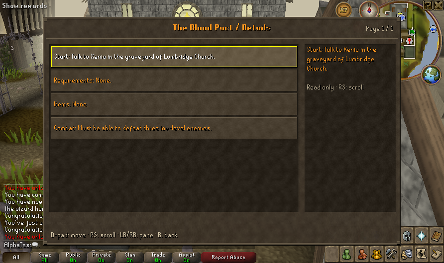
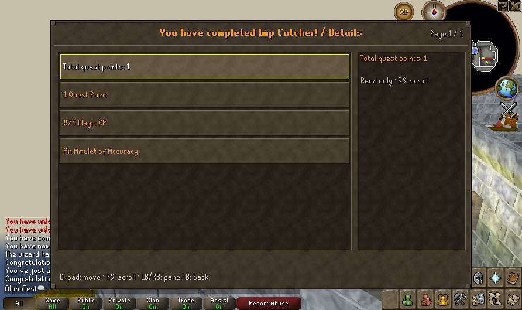

# Early quests and production coverage — 13 October 2026

This batch expands native quest and production checks while the owner playtests the controller-only session on the Deck. Validation used isolated host worlds. This merged batch was subsequently deployed to the Deck as r24; see [release deployment](UI_DECK_RELEASE.md#content-build-r24).

## Changes

- **Quest introductions:** the custom quest view now exposes loaded start location, requirements, items, combat and reward text, with section labels. Native Yes/No buttons retain their actions in the controls pane. Decorative/toggle text is excluded.
- **Quest rewards:** standard and wide reward interfaces participate in the custom quest presentation. Loaded reward text stays read-only; total quest points have a clear label. Turning off custom quest screens retains native presentation.
- **Production choices:** recipe names come from the same native string/item variables used by the game interface, replacing repeated “Continue” labels. The widget item field and action tokens used for native dispatch remain unchanged. Changed recipe names invalidate stale controller selections.
- **Pottery:** the oven’s Fire action now chooses an item with an actual firing recipe. Previously a finished empty pot earlier in the inventory was selected, and the operation returned without opening production. The regression uses a finished pot, soft clay and an unfired pot together, and checks that only the unfired pot is fired.

Client patch: `0046-readable-quest-intros-and-rewards.patch`. Server patch: `0019-pottery-fire-skip-finished-items.patch`.

## Coverage and limits

| Content | Native server cases | Graphical client coverage |
| --- | ---: | --- |
| Blood Pact | 1 completion fixture | Real Xenia dialogue, readable quest introduction and native Yes. **Earned controller-only completion** from a fresh character with real travel, combat, loot and save/Continue: [sprint batch 2](DECK_SESSION_SPRINT.md#batch-2-earned-blood-pact-through-controller-input-client-patch-0052---blood-pact-probe) |
| Imp Catcher | 1 completion fixture | Real Mizgog dialogue, completion/cutscene and readable reward interface using supplied beads |
| Druidic Ritual | 1 completion fixture | [Native completion, journal and save/reload fixture](DRUIDIC_RITUAL_GRAPHICAL.md) |
| Spinning | 1 | Native wheel Spin and wool-to-ball recipe |
| Pottery | 3 | Soft clay → unfired pot → fired empty pot with the normal starter inventory |
| Smelting | 19 | Copper/tin → bronze bar |
| Smithing | 6 | Bronze bar → dagger through the native smithing model and Make 1 action |
| Fletching | 9 | Knife/logs → arrow shafts through item-on-item and the native production prompt |

The server cases total **41**, all passing. Existing server quest fixtures supply items, teleport and sometimes deal combat damage; they establish quest logic, not an earned playthrough. The graphical fixture supplies beads/materials/tools and places the character in each native scene through the disposable admin account. It uses ordinary controller gateways and native widget actions afterwards; it does not inject completion or claim real travel/resource gathering. Physical pad input and Steam Input layouts remain owner acceptance.

The existing actual walking journeys for Cook’s Assistant, Rune Mysteries and Restless Ghost are documented in [route audit](ADVENTURE_ROUTE_AUDIT.md). They provide different evidence from this batch.

## Reproduce

```bash
./scripts/test-content-coverage.sh
./scripts/smoke-profile.sh --content-coverage
```

The first command runs the eight selected suites with isolated storage and saves a summary under `.runtime/content-coverage/`. The second uses the matched client/server, a private display, supplied-material fixtures and native gateways. Raw profiles, logs, authentication and cache resources remain private.

## Validation evidence

- Client: 248 cases, zero failures/errors, one optional SDL skip.
- Exported patches reproduce all 138 client and 52 server modified/patched files.
- [Server summary](evidence/server-content-coverage.json) records all 41 selected cases.
- [Native fixture results](evidence/native-content-coverage.json) record quest text, recipe names and produced quantities.
- Native New/Continue preserves saved fields; four backups verify; cancelled startup preserves the entire saved world and legacy mutable paths remain unchanged.

These captures use actual native quest data rendered by the controller overlay on a private host display. The fixture supplies beads and scene placement; screenshots do not establish a physical controller playthrough.




## Next playtest checks

- Start a quest, read its requirements, confirm Yes, and check its journal as progress changes.
- Complete Imp Catcher and leave the reward screen with B.
- Shape and fire a pot while carrying an existing empty pot; verify that the existing pot remains.
- Make a bronze bar and dagger, then fletch shafts; check quantities, cancellation and inventory changes.
- Full Blood Pact combat, Druidic Ritual travel and other pottery recipes still need broader graphical and physical coverage. The audit also identified a separate unfired-pie-dish mapping to bowl in the upstream pottery table; that recipe is outside this batch’s verified pot path.
