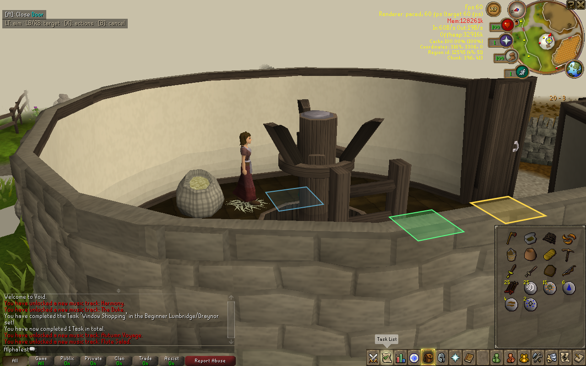
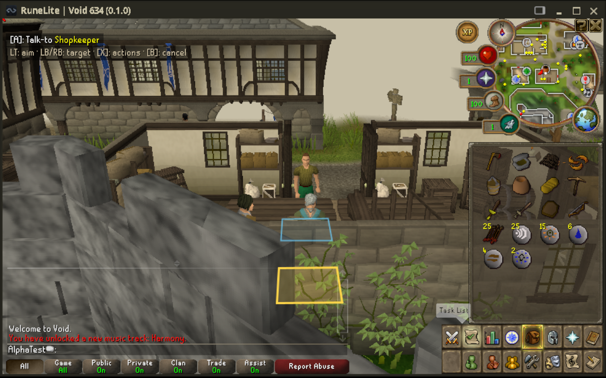

# Representative controller validation on Steam Deck — 14 October 2026

The owner clarified the objective: learn from representative interactions and apply shared contracts to future tasks, rather than run every quest. The coordinator tested the Deck while a supervised Claude Sonnet worker investigated cooking, shop and settings probes in a separate checkout. Future work follows [shared controller acceptance](CONTROLLER_INTERACTION_ACCEPTANCE.md).

## Installed baseline and save protection

The reviewed overnight work is merged as `dae017a` (PR #21). Its private matched baseline is installed as `deck-lessons-20261014-r29`. All **10,580** manifest entries verified before activation. The idle owner profile received a fresh verified backup; all **106** copied profile files matched their source hashes. The character save had zero raw backslashes, so the server 0022 escape-reader compatibility check passed. Launcher settings were copied unchanged and r28 plus the previous stable wrapper remain available for rollback.

The endurance measurements below use r29 (client patch 0052); the final candidate is r30 (client patch 0053), described below. All tests used disposable AlphaTest worlds through a separate temporary Steam shortcut. After the endurance run, the real character save still matched r28 byte-for-byte and no disposable session remained active. A later ended owner session changed that save; the final deployment preserves the latest valid save rather than restoring r28.

## Steam-launch portability lesson

The first quick run failed before gameplay: Steam's C locale made Java 8 compile the harness as ASCII, rejecting a Unicode arrow in a source comment. The shared compiler now explicitly requests `-encoding UTF-8`. All 18 native harness sources compiled under `LC_ALL=C` after the fix, and all 110 tooling tests passed. The reusable `scripts/deck-controller-validation.sh` also supports older installed tooling with a validation-only UTF-8 JVM override. This did not alter the installed baseline's game jars or manifest-listed scripts.

## Short graphics and lifecycle checks

The actual Steam-launched Gaming Mode run used `DISPLAY=:1`, an AMD hardware OpenGL renderer, a focused 1280×800 canvas and a connected controller. The tab-bar probe feeds scripted input; this is not a human button-acceptance claim.

| Capped stage | New | Continue |
| --- | ---: | ---: |
| Average callback FPS | 59.99 | 60.01 |
| p95 interval | 18.03 ms | 17.93 ms |
| p99 interval | 18.84 ms | 18.91 ms |

Each stage runs for 25 s and samples after its first ten seconds. Tab navigation, New/Continue, backups, unchanged saved fields and whole-world preservation on startup cancellation passed. [Short-run evidence](evidence/deck-controller-20261014/r29-quick.json).

## Sustained Gaming Mode route

The external-power run completed **five full loops over 2,168.60 s (36.14 min)**. The loop includes walking, camera changes, bank/shop opening and closing, dialogue, earned combat, inventory and map transitions. It finishes the current loop after the requested 30-minute threshold. These are scripted native interactions on real Deck hardware, not a physical controller playthrough.

| Native callback trace, 1280×800 OpenGL | Result |
| --- | ---: |
| Samples | 128,025 |
| Average FPS | 59.04 |
| p95 interval | 19.53 ms |
| p99 interval | 22.35 ms |
| Maximum interval | 1,344.30 ms |
| Minimum rolling five-second FPS | 15.76 |
| Peak combined client/server RSS | 2,972.21 MiB |
| Peak amdgpu temperature sensor | 56°C |

All recorded `ACAD/online` readings were 1. Per-process peaks were client 1,310.12 MiB and server 1,662.09 MiB. The lower hardware-OpenGL client RSS differs substantially from the overnight host software-renderer result; those environments should not be compared as the same workload/renderer. Loading and transition stalls remain in the trace. The duration criterion passed, but the strict p99 ≤20 ms and rolling ≥58 FPS criteria **did not pass**. Average FPS near 60 does not imply uninterrupted 60 FPS.

A separate passive 30-minute XWayland observer recorded **106,274 completion events across five GL window lifetimes**. Per-lifetime averages were 59.28–59.46 FPS with p99 16.76–16.94 ms, retaining 0.75–0.98 s stalls. This excludes unobserved gaps and software-map frames and does not measure physical panel scanout. [Presentation evidence](evidence/deck-controller-20261014/r29-present.json).

New and Continue, saved-field preservation, backups, unchanged original mutable paths and whole-world preservation on startup cancellation passed; session totals were 2,209.46 s and 47.75 s. [Route, frame-time and resource evidence](evidence/deck-controller-20261014/r29-route.json). Full private CSV/resource samples are retained under `.runtime/deck-controller-evidence/r29-route/`.

This is the real 1280×800 Deck display with the disposable AlphaTest character. Gamescope saved an AVIF capture; the original remains private and its PNG was decoded for publication without changing the scene. The capture used Gamescope's [screenshot signal handler](https://github.com/ValveSoftware/gamescope/blob/master/src/main.cpp).

## Shared UI follow-up

The parallel worker is checking the native action/container contracts rather than modifying quest content. The shop's side inventory must be observed while the shop is open, and dispatch rejection must not silently advance a probe. The cooking probe also cleared its planned B state before passing input to the plugin; corrected input and strict cancellation acceptance distinguish that test defect from a product failure. The bounded Sonnet pass confirmed a production defect: stock click boxes and item graphics were separate, so the generic controller adapter discarded populated stock as empty slots. Patch 0053 joins the current graphic metadata to its native click box, preserving action identity. Strict native shop acceptance now requires an actual purchase and persistence after Continue. Cooking cancellation now passes on the first B, with raw food unchanged; there was no cooking product defect.

The focused Settings follow-up makes the harness own its virtual input through real plugin ticks and restores the previous SDL polling state. New/Continue and full adventure probes passed on the private host. No production Settings change was needed. See [Settings evidence and limits](SETTINGS_HARNESS_OWNERSHIP_20261014.md).

The Steam-launched launcher fixture also passed controller name entry, focus, held-A protection, account filtering, private creation and inline backend rejection on the Deck. It used scripted controller input, not human button acceptance.

## Final candidate

The immutable r30 snapshot is sourced from `fd18da7` and all **10,597** manifest entries verified. Its game jars contain client 0053/server 0022. Deployment found an ended, unverified owner session: no recorded game process was live, and recovery checks allowed its record to be archived without signalling a process. The newest character save validated and received a fresh backup. All **110** copied profile files matched their source hashes, the latest character save and launcher settings copied unchanged, and r29 remains available for rollback. This validates the copy and current save format, not clean closure of the earlier session.

Post-fix Steam Gaming Mode checks are separate from the r29 endurance baseline. The strict shop route passed: sell dagger → 4 coins, buy jug → 3 coins, jug and coins persist after Continue; New/Continue took 77.161/27.389 s, and startup cancellation preserved the world. [Shop evidence](evidence/deck-controller-20261014/r30-shop.json).

Settings adoption, reversible preferences, B to Home, restored SDL polling, logout and same-client relog passed in both sessions. The overall smoke run is **partial**: strict saved-field equality caught a one-tile difference, from (3221,3219) after New to (3222,3219) after Continue. Account, experience and inventories matched. The cause remains unresolved, the comparison stays strict, and startup cancellation was not reached in this Settings run. [Settings evidence](evidence/deck-controller-20261014/r30-settings.json). Do not infer save corruption from this observation.

At the restart checkpoint, the latest owner save still matched its r29 transfer source byte-for-byte, and no owner or disposable session record remained active. PR #23 is merged. PRs #24 and #22 remain open pending the required code-owner review; CI passes and no administrator bypass is authorized. The user requested a pause for a host restart. Resume with the bounded Settings tile-change investigation, then frame-time stalls rather than more quest runs.

Battery-only comparisons, physical button acceptance and suspend/resume remain separate checks. No exhaustive quest campaign is required for this validation.

## Resumed diagnostics after host restart

Added Settings tile/input snapshots and precise strict-save mismatch field names, without changing game jars or weakening equality. Two fresh Steam-launched r31 diagnostic runs passed all Settings contracts, exact saved-field equality and whole-world startup cancellation. New/Continue totals were 51.598/47.593 s and 50.249/47.717 s. Tile stayed (3221,3219) across the observed world-ready and relog samples; recorded axes/buttons were neutral. These samples do not exclude input between observations. The earlier r30 one-tile difference remains unexplained rather than being reclassified as fixed. [Diagnostic Settings evidence](evidence/deck-controller-20261014/r31-settings.json).

Claude Sonnet analysed the existing full r29 traces and prepared loading code in bounded tasks. Worst stalls cluster at synchronous region rebuilds and OpenGL/software map transitions; GC is a possible component requiring measurement, while steady frame-time jitter remains a separate hypothesis. See [stall diagnosis](DECK_STALL_DIAGNOSIS_20261014.md).

The coordinator added route-only columns for completed timing-counter deltas, tile/scene base, renderer and coarse cumulative GC time. They sample between overlay callbacks, with phase overlap and callback-boundary offsets explicitly recorded. Sampling allocations can affect the run; it is diagnostic evidence, not a replacement benchmark. The r32 diagnostic snapshot verified 10,603 manifest entries and retains r30 game jars. One existing route loop is underway with a 60-second minimum, which completes the current loop. The stable player shortcut stays on r30 and these diagnostic snapshots contain no owner save.
