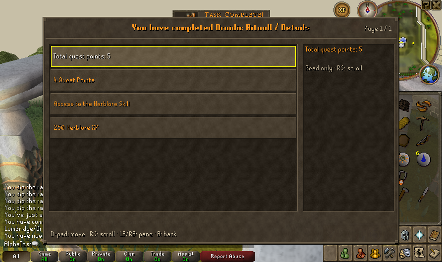
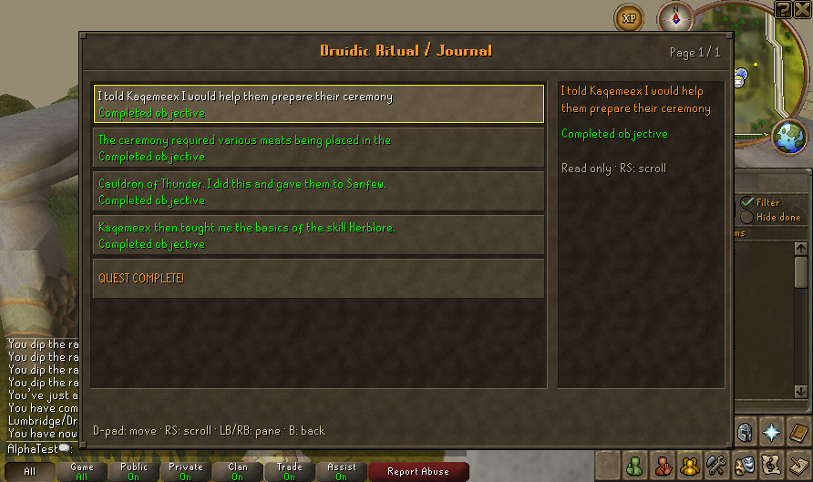

# Druidic Ritual graphical coverage — 13 October 2026

The native client fixture completes Druidic Ritual through normal controller gateways: Kaqemeex's quest choice and Yes, Sanfew's instructions, Use on each raw meat followed by Use on the Cauldron of Thunder, Sanfew's hand-in and Kaqemeex's reward. It dismisses the Herblore level-up Continue, scrolls the native quest list to Druidic Ritual, and opens the completed journal.

All four raw meats disappear individually and become the corresponding enchanted meat; Sanfew consumes all four. Native rewards show four quest points, Herblore access and 250 Herblore XP. The resulting five total quest points include the earlier Imp Catcher fixture. Save validation checks completed quest states, 250 Herblore XP (2500 native save units), and the five-point total on New and Continue.

## Save reload fix

This sequence exposed an actual Continue failure: recent-event descriptions exceeded the save reader's fixed 100-byte string buffer. `ConfigReader.quotedString` threw an array-bounds exception during native account loading. Server patch `0021-grow-save-reader-string-buffer.patch` grows the reused buffer when needed for strings, keys and sections. It preserves escaped-quote handling and existing serialized bytes; no save migration is required.

The configuration module's **82 tests pass**, including eight new boundary/event regressions. The selected native quest/production suites' **53 tests pass**. Client tests remain **248**, zero failures/errors, one optional SDL skip. The patch stacks reproduce all 138 client and 55 server modified/patched files. Matched jars build.

The final New/Continue run completes in 150.189/22.979 seconds, including client readiness, actions and save/shutdown. Four backups verify before the cancellation check; saved backup characters also pass the quest/reward validator. Account, XP, inventories and tile survive Continue; cancelled startup preserves the entire saved world and legacy mutable paths are unchanged.

Evidence: [graphical and save results](evidence/native-druidic-coverage.json), [configuration regressions](evidence/save-reader-regressions.json), [server quest/production regressions](evidence/server-druidic-sprint.json).

## Scope

This is a private host/native-cache fixture. It supplies meats and places the character at each real scene; it does not inject quest progress, completion or enchanted meats. Already-verified production outputs are dropped before supplying the meats to leave inventory room. It calls normal fresh controller UI/world gateways; physical controller input, hunting the animals, walking the dungeon route and combat acceptance remain playtest coverage.

The captures render actual quest data through the existing controller overlay in the native client. Raw saves, logs, authentication and standalone cache assets stay private.

This pass also adds [animated launcher braziers](JAGEX_UI_OVERHAUL.md#animated-launcher-braziers), with a sampled animation, screenshot and host paint measurements.
