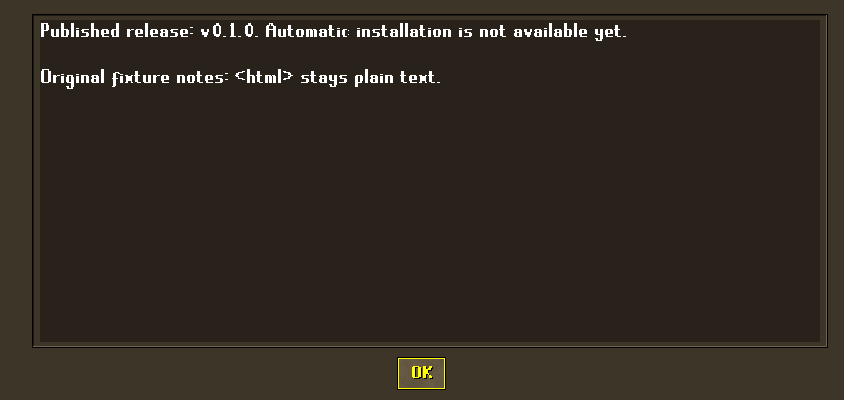

# Launcher release discovery — 17 October 2026

Launcher Settings now has a controller-accessible Check for updates button. It checks the project's stable public GitHub release metadata and shows release notes, no-public-release or unavailable status. It does not download or apply an update. There are no public releases at the time of the live check. [Packaging/install next steps](GITHUB_UPDATES.md) remain open.

## Real native UI findings and fixes

The first real Swing/controller-adapter probe could open Settings but could not navigate its contents. A invoked the modal action within the controller timer callback; Swing coalesced that timer until the modal action returned. Activation now runs in the next UI event, with captured window/focus checked before it acts.

The nested release-notes dialog also needs complete launcher owner ancestry, rather than a direct-parent check. B now restores the parent's window/focus after closing a dialog. This addresses the observed parent-focus failure on private Xvfb without changing in-game input handling. A late metadata response does not reopen Settings after cancellation.

The final matched native jar passes:

- Mapped A opens Settings; directional input reaches the new check button; mapped A opens the response.
- Release notes remain plain text, including literal HTML-looking fixture text.
- B closes the nested response, preserves Settings, restores parent focus, then B returns to the launcher.
- Cancelling Settings during a delayed check produces no late popup.
- Normal launcher close completes.

The existing real launcher probe also passes: held-A entry guard, controller naming, account filtering, B/Y field behaviour, private character creation, backend rejection, world-rate persistence, scene animation pause/resume and exclusive Steam keyboard ownership. These are host Swing/adapter tests; they do not establish physical SDL buttons, Steam Gaming Mode, Deck frame pacing or controller acceptance on hardware.

## Evidence

Seven metadata/backend tests and all159 root tooling cases pass (one existing optional skip). They cover malformed/oversized/wrong-project metadata, redirects, rate limits/offline/server failures, active-world refusal followed by Stop, and unavailable install/custom-feed requests. The real API check returns `no_public_release`; the native UI uses deterministic private metadata.

Final native UI output: `.runtime/launcher-tests/1792256007081762483/update-ui-result.json`, log `.runtime/github-update-discovery-20261017/ui-verified.log`. Existing probe: `.runtime/launcher-tests/1792256015426859097`, log `ui-existing-regression.log` in the same discovery directory. Red and intermediate diagnostic runs remain private; source overrides used during diagnosis are not cited as the final jar acceptance.

The normal matched source build passes, with all138 client and80 server modified files matching their exported stacks. [Sanitized evidence](evidence/github-update-discovery-20261017.json) records the actual jar/patch identity and tool hashes. No owner profile, Deck installation, package publishing or cache redistribution occurred.

This screenshot uses fictional release metadata to test the dialog. It is not a published release or an available installer.
