# Jagex-style UI overhaul (13 October 2026)

The launcher and every SoloScape-owned in-game surface now follow the classic RS2 / OSRS interface conventions. This replaces the earlier warm "classic" palette. The **Classic controller UI** setting still switches to the earlier modern slate look, which is unchanged.

The work is in three client patches:

- `0042-jagex-ui-overhaul.patch` is presentation only. It changes no server, gameplay, save, projection or native-action code.
- `0043-dpad-tab-bar-focus.patch` adds the owner-requested D-pad tab-bar focus. See [D-pad tab-bar focus](#d-pad-tab-bar-focus) below.

- `0044-native-ui-artwork.patch` adds all 25 bundled native skill icons and current/base levels. Item cells keep using the native item sprite bridge.

No server patch changed.

## What changed

| Convention | Where it applies |
| --- | --- |
| **RuneScape bitmap fonts** (plain, bold and small faces already in RuneLite's `FontManager`). They are drawn without antialiasing and snapped to 16/20/24/32 px, so strokes stay even. Every label has a black drop shadow of 1 px per 16 px of type. | All controller panels, wheels, the HUD, keyboards and the launcher |
| **Mottled brown stone**: a deterministic texture generated in code (no cache art). Frames have a black keyline, a raised bevel, a thin inner wall and corner studs. Item and details areas are recessed wells. | Panel frames, cells, buttons, wheel wedges and hubs, launcher frames and buttons |
| **Classic text colours**: orange titles and labels, item names in item orange, white values, yellow for focus and the selected action, and muted parchment for hints | All text |
| **Stack counters** at the top-left of item pictures: yellow below 100K, white "184K" up to 10M, green "12M" above | Inventory, bank, shop, equipment |
| **Quest-list colours**: red not started, yellow in progress, green completed (name and state) | Quest list and journal objectives |
| **"Choose Option" menu**: black title strip, brown body, white option followed by the target name in its kind colour (NPC yellow, object cyan, item orange) | Inventory context actions and world action menus. The loot pile keeps its "Loot pile · n / m" title and seven-row window. |
| **Mouseover-style action line**: white option text and a coloured target name in the corner, with no floating text over the target | World HUD; it reuses the existing prompt strings, so no approach/range wording returns |
| **Parchment chatbox prompts**: black prompt, blue entry with the `*` cursor | Controller amount/name keyboard and the Steam text-entry panel |
| **Pale-yellow tooltip** (#FFFFA0, black keyline, black text) | Panel hover tooltips and launcher tooltips |
| **Selection without relying on hue alone**: lighter stone, a yellow keyline inside the bounds, and a solid left marker on actions and menu rows | Cells, action rows, menu rows, wedges, launcher buttons and keyboard keys |
| **Uniform wheel labels**: every Home wedge uses one face and size, and unavailable tabs are greyed | Home tab wheel |
| **Empty state**: a pane with nothing to show says "There is nothing here." | Panels |

### Launcher

The launcher keeps the original mirrored brazier scene, now with a vignette, and the following changes:

- **Title:** an orange RuneScape-bold title with a yellow tagline.
- **"Select a Character" frame:** a stone interface frame holds the character list. Each row shows the name in orange and the state in colour: green Continue, yellow New, red Earlier session/Needs recovery.
- **Details:** the selected character's details sit on a parchment scroll in dark ink.
- **Controls:** all launcher dialogs (New Character, World Settings, Restore, Manage Backups, Diagnostics, Launcher Settings and Recover Session) share stone buttons, recessed fields, stone scrollbars, combo boxes, check boxes, split panes and fonts. Focused or hovered controls light yellow, so the controller cursor is always visible.
- **World Settings:** rates read as multipliers such as 5×. Modern question/information icons are removed; warnings and errors keep theirs.
- **New Character keyboard:** the key under the controller cursor shows the same yellow keyline instead of a blue fill.

## D-pad tab-bar focus

| Situation | Behaviour |
| --- | --- |
| **Entering** | With world input active and no inventory or panel focus, dialogue, world or loot menu, item selection, radial or keyboard, a fresh D-pad left or right press focuses the native bottom-right tab bar. The Inventory slot starts highlighted (or an edge slot when Inventory is hidden). The bar refuses to take focus while the native bar is hidden, for example during dialogue, modal panels, text entry or login. |
| **Cycling** | Further left/right presses move the highlight through the available slots in native visual order: rows top to bottom, left to right. The order comes from the slots' rendered bounds and works in fixed and resized frames, with the frame's known order as a fallback. Hidden slots are skipped, the order wraps, and the map orb and logout button are not bar slots. Cycling never opens a tab. |
| **Highlight** | The native slot gets a black-backed yellow keyline and a pale-yellow tooltip with its name. The corner HUD shows `[A]: Open Skills` and `D-pad left / right: choose tab · [B]: back to world`. Physical labels follow button remapping and glyph choice. |
| **A** | While the bar is focused, A has no world role: world targets and actions are cleared, and the camera stays live. Only a fresh A press confirms. An A held while entering, or pressed or held together with a direction, never confirms. |
| **Opening** | A opens the highlighted tab through the existing native, permission-checked tab operation. Tabs with controller screens (inventory, equipment, prayer, spellbook, combat, skills, quests and settings) take UI focus. Tabs without one, such as friends or music, open natively and leave input with the world. |
| **B** | B deselects the bar and returns to world input. B in a tab opened from the bar leaves straight to world input, with no stop at the bar or the Home wheel. Nested and modal cancellation inside that tab is unchanged. |
| **Other D-pad uses** | D-pad navigation in inventory, panels, dialogue, production and amount prompts, world and loot menus, radials and keyboards is unchanged. The bar only enters from idle world input. Y, View and Start hand focus to their owners immediately. Lifecycle resets (focus loss, rebinding, logout, text ownership, adapter errors) clear the bar, and the existing neutral re-arming applies. |

The logic lives in `TabBarControls`, with five unit cases. `ControllerUi.tabBounds()` reports the rendered slot bounds. The plugin tick body moved into `processInput(started)` without behaviour change, so native probes can script it.

## Invariants kept

- Layout geometry, page sizes, hit boxes, native action tokens, focus semantics and mouse capture are unchanged. Every helper draws inside the rectangle it is given, and a regression test checks for pixels outside those bounds. The existing hit-map tests pass under the new metrics.
- The launcher keeps the same component names, button texts, focus order, backend protocol, ownership locks and keyboard/Steam ownership. The native launcher probe still passes.
- Gameplay, saves, per-world settings, occupied-slot inventory navigation, reversed horizontal camera, corner target prompts, full-pile loot browsing, player-lit fire Use, the `ControllerProjection` renderer-state fix and the player tile without a destination are all untouched. The world target footprint and movement tiles are unchanged, which keeps health bars and the scene readable.
- The modern palette restores the earlier presentation exactly; its code paths are kept separately rather than reinterpreted.
- No proprietary cache resources are tracked. The fonts are RuneLite's bundled fonts, already in the upstream source. Textures are generated in code. The previews' world backdrop is the existing tracked `alpha-native-private-world.png` capture.

## Previews

The three "Live client" images are real native captures from the disposable `--tab-bar` and `--adventure` sessions. The other in-game images are renderer fixtures from `scripts/harness/JagexUiPreview.java`. They draw real overlay code with synthetic data over a native world capture. Item pictures are actual 634-cache sprites captured by `--artwork`; skill icons are the bundled native resources. Fixture quantities and selections remain synthetic. The launcher images are actual Swing captures from `scripts/smoke-launcher.py` on a private display.

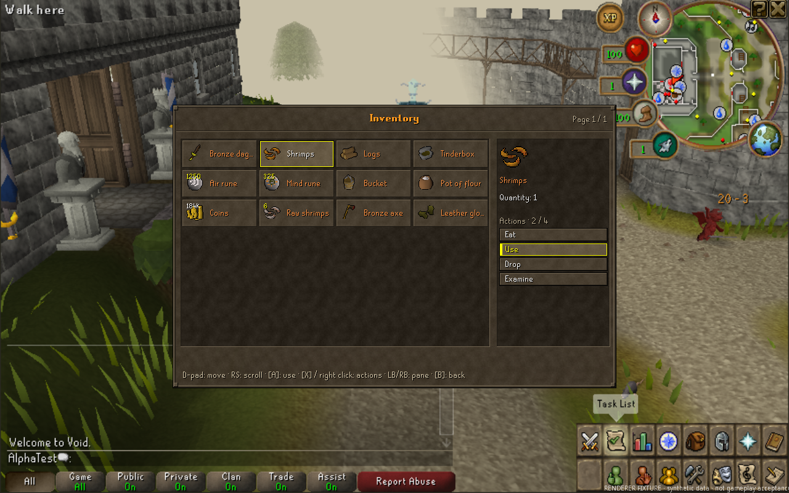
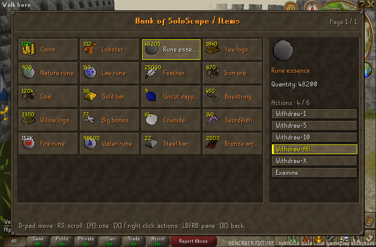
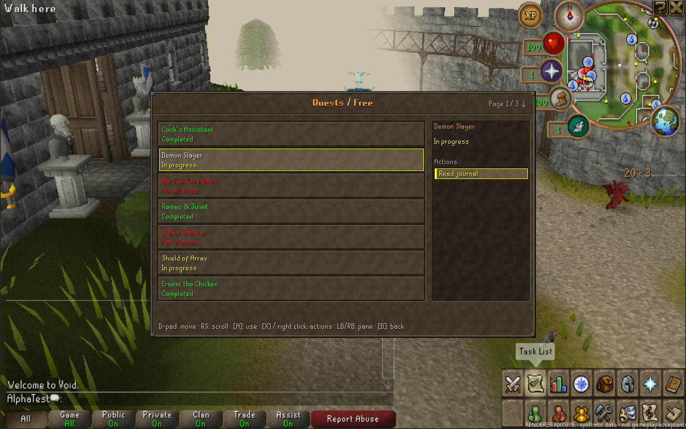
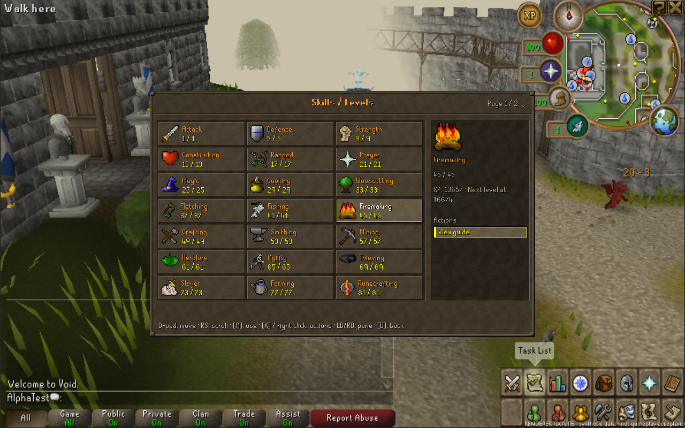
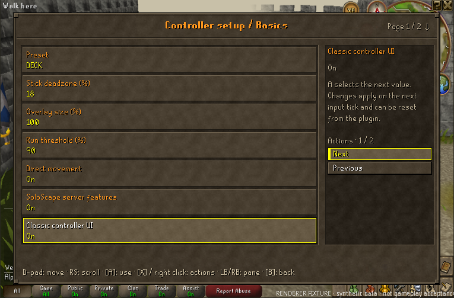
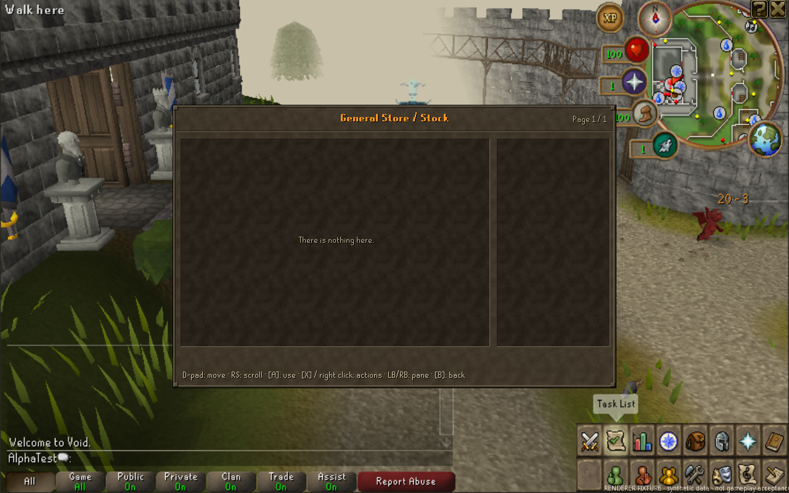
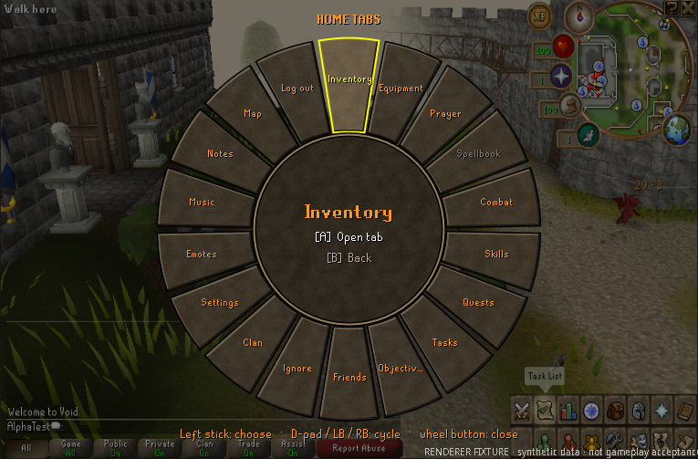
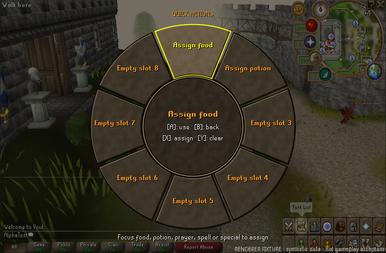
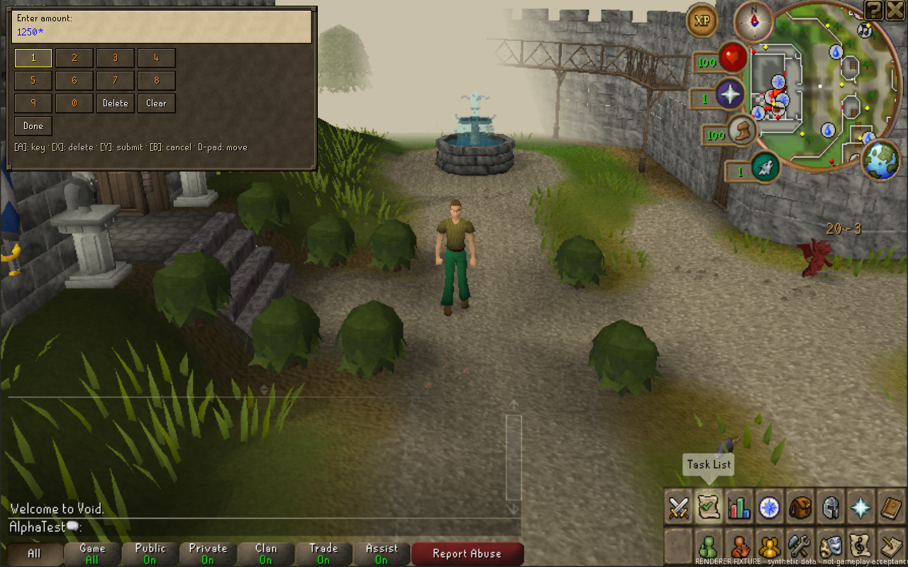
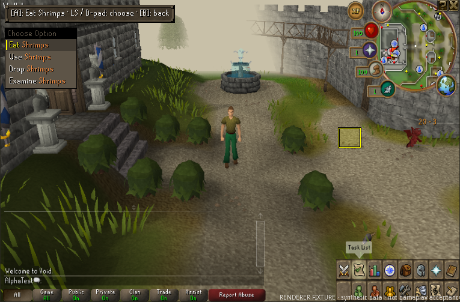
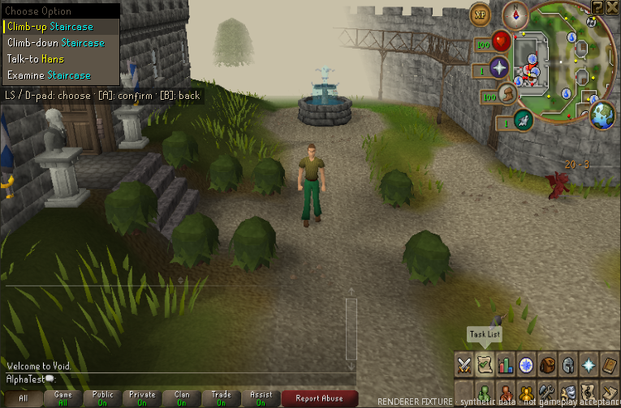
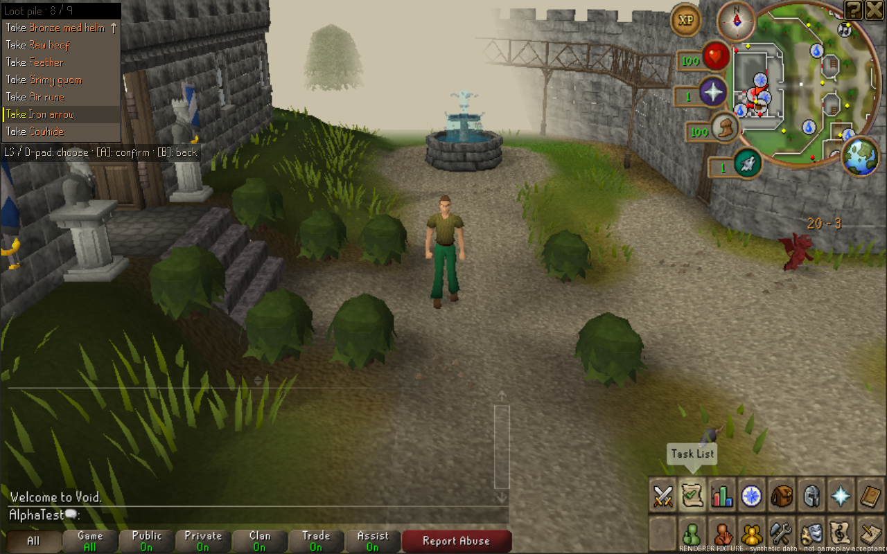
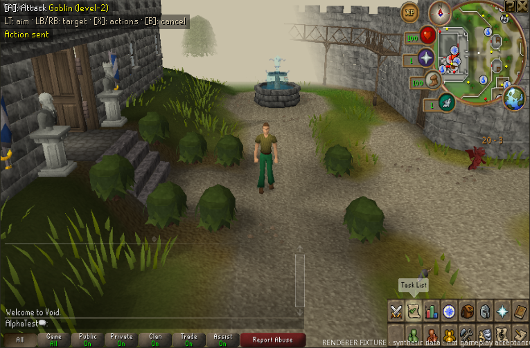
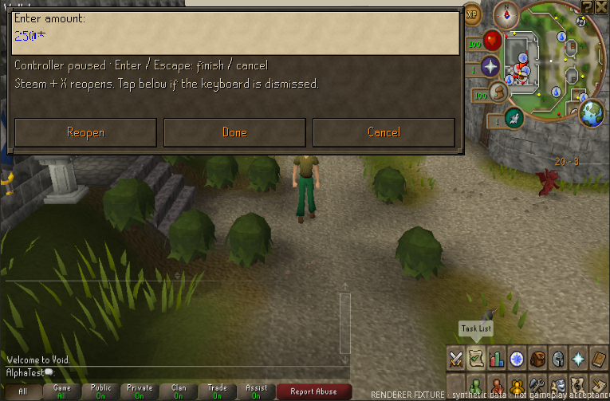
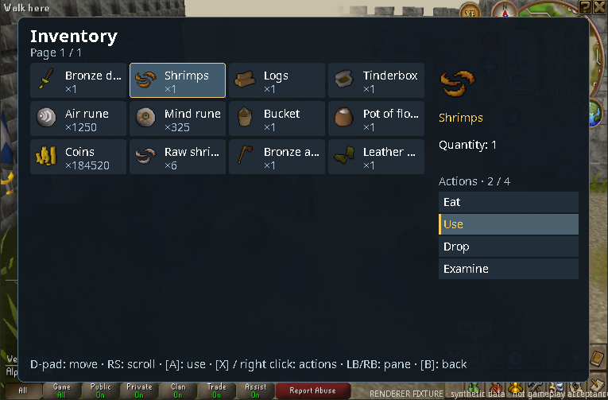
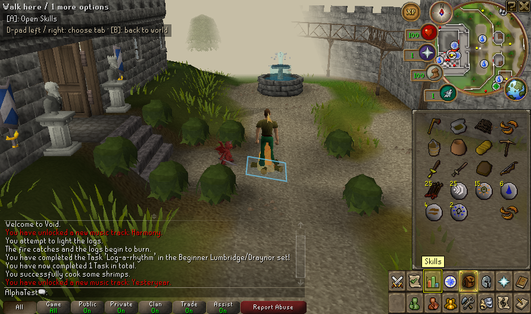
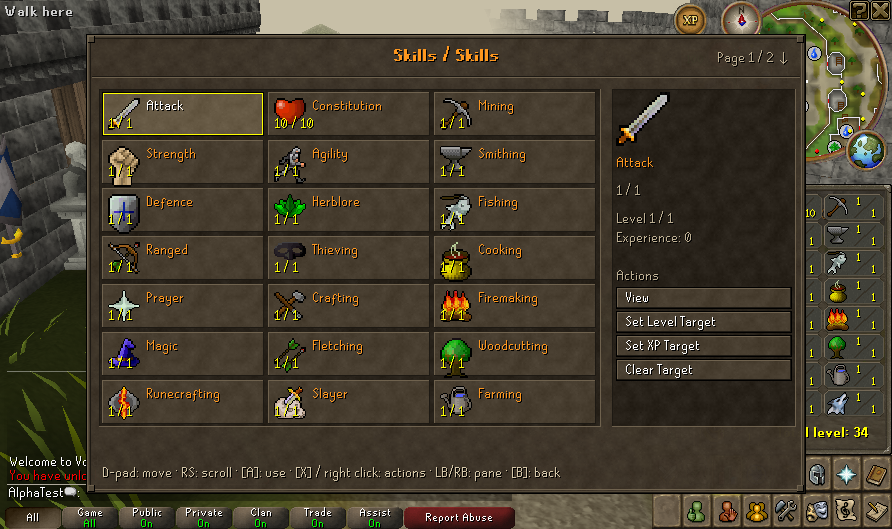
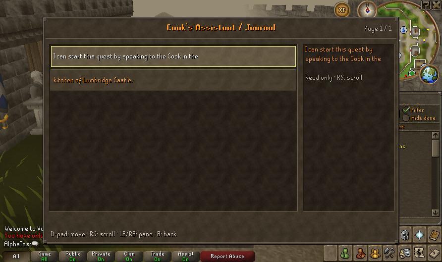
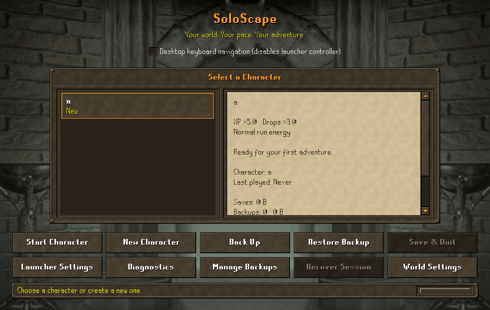
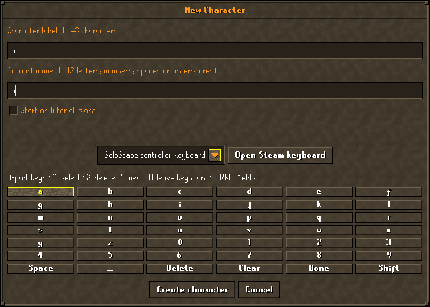
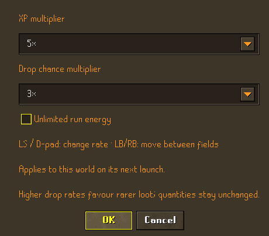

To regenerate the fixtures, first run `./scripts/smoke-profile.sh --artwork` to capture sprites from the locally supplied compatible cache, then compile and run the harness against the built client jar:

```bash
javac -cp <void-client jar> -d <dir> scripts/harness/JagexUiPreview.java
java -Djava.awt.headless=true -cp <void-client jar>:<dir> JagexUiPreview <output dir> docs/images/alpha-native-private-world.png <native-login.marker.artwork dir>
```

## Validation

- **Client regressions:** 241 cases, zero failures or errors, one existing optional SDL skip. The previous total was 230. New coverage: two native artwork cases, four theme cases (every palette colour initialised in both palettes, fonts, classic colour rules, helpers drawing only inside their bounds) and five tab-bar cases. The existing hit-map tests pass under the new font metrics.
- **Root tooling:** 99 passing cases. Python compilation and whitespace checks pass.
- **Source reproduction:** the client stack (now through 0044) reproduces all 135 modified or patched files; the server stack reproduces all 50. The matched jars were rebuilt with `prepare-build.sh` and the build stamp refreshed.
- **Launcher:** `smoke-launcher.py` passes against the built jar. It covers the real Swing launcher, backend, controller name entry, held-A guard, account filter, Steam keyboard ownership and World Settings saving 5×/3×. The probe now also captures the World Settings dialog.
- **Tab bar:** `smoke-profile.sh --tab-bar` passes in the real client, with New and Continue. Scripted pad states run through the plugin's own input tick. The probe checks:
  - entry onto Inventory with A pressed at the same time, opening nothing;
  - the measured native order "Combat, Tasks, Skills, Quests, Inventory, Equipment, Prayer, Spellbook, Friends, Ignore, Clan, Settings, Emotes, Music, Notes" (the hidden Objectives slot is skipped);
  - a highlight equal to the native slot bounds;
  - one-slot moves without opening;
  - no confirmation from A held through cycling or A pressed with a direction;
  - a fresh A opening the native Skills tab, which the custom Skills screen adopts;
  - B returning to world input rather than the Home wheel;
  - re-entry and B deselection.
- **Adventure:** `smoke-profile.sh --adventure` renders the live journal in the new style, then fails at "Settings disappeared on second tick". The **pre-overhaul baseline jar fails at the same step with the same message** (checked by temporarily stamping a baseline build, then restoring and re-verifying the candidate jar and stamp). This is an existing probe/controller-settings issue, not caused by this work. It is left for separate investigation.
- **Playtest two:** `smoke-profile.sh --playtest-two` passes on the final build. Player-lit fire Use cooks shrimps (cooked count 1 → 2). The Blood Pact plane-1 instance draws the player polygon, the idle player tile renders without a destination (2070 pixels) and the direct destination is kept. New/Continue saves pass, and startup cancellation preserves the whole world.
- **Evidence:** `.runtime/alpha-tests/session-1791886349751352140/` (tab bar), `session-1791886423933596647/` (playtest two) and `.runtime/launcher-tests/1791885342109479195/` (launcher).

## Limits

- The native, launcher and fixture checks above ran on owned virtual displays or software renderers. They are not physical Steam Deck or Gaming Mode acceptance. Text comfort at Deck viewing distance, especially at the 16 px base size, needs an on-device look; **Overlay size (%)** steps the type through 20, 24 and 32 px.
- The RuneScape plain face draws zero with a slash ("Ø"-like). That is the font as RuneLite ships it.
- Stone textures are filled each frame while a panel or wheel is open, and only then. The world HUD stays untextured. Current Deck measurements and their limits are recorded in [UI Deck release](UI_DECK_RELEASE.md).
- Native game interfaces (the 634 client's own panels, dialogue and chatbox) are not repainted. SoloScape surfaces now match their conventions instead.
- Deployment and current on-device measurements are recorded in [UI Deck release](UI_DECK_RELEASE.md).
- The tab-bar check scripted pad states through the plugin's input tick. A physical controller, Steam Input layouts that map the D-pad elsewhere, and Gaming Mode remain acceptance items. While the bar is focused, world movement pauses; the camera stays live.
- `--adventure` fails at a pre-existing step (see Validation), so that probe gives no full pass here.

## Launcher text readability follow-up

Owner feedback on the r24 launcher: character text and supporting text need another 1–2 px. Client patch `0047-launcher-readable-body-text.patch` increases supporting text from 20 to **22 px**: character names/status, parchment details, subtitle, frame heading, status line, controls and dialog fields. The SoloScape title and button typography retain their existing sizes. Character rows increase from 60 to 68 px to accommodate both lines.

The client shadow jar builds. The existing real Swing launcher/backend probe passes mapped navigation, held-A protection, name entry, account filtering, B/Y transitions, profile creation, rate persistence, inline validation and exclusive Steam text-entry ownership. Its launcher capture now uses **1280×800**; the screenshot below was visually checked for row/footer fit and readable details. The character and rates are disposable fixtures. This check uses a private host display and does not establish physical Deck controller acceptance or FPS.

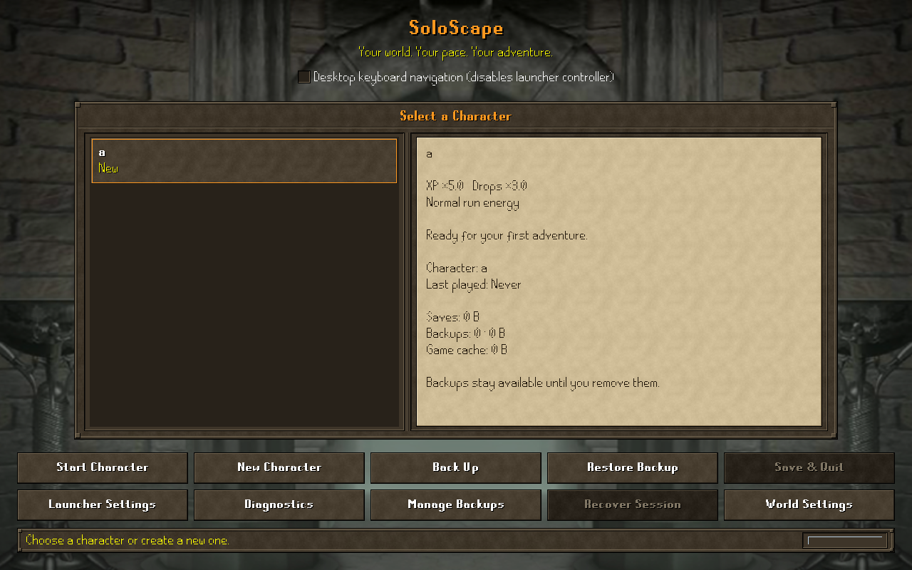

The r24 Deck installation is ready for the ongoing playtest; this text follow-up is intended for the next build. Animated flames in the original brazier scene remain a requested [UI follow-up](DECK_SPRINT_TASKS.md#launcher-charm-follow-up).

## Animated launcher braziers

Client patch `0048-animated-launcher-braziers.patch` lights both bowls in the original mirrored RS2 scene. Independent small heat fields produce rising pixel flames, warm light flicker, bowl highlights and drifting embers. Their coordinates scale with the original half-scene artwork when the window resizes. The existing image is supplied locally; no standalone cache resource is tracked.

The Swing timer targets 30 updates per second. It stops while the launcher is hidden/minimized, removed/disposed, or its owned world is running, and resumes when appropriate. Missing artwork keeps the static fallback without an animation timer. The stone scene, dimming and vignette are cached per window size; the timer updates the flame fields and redraws the cached scene.

The real launcher/backend probe passes existing mapped-navigation and name-entry checks plus visible animation, gameplay pause, hidden pause and resume. A private host Swing/Xvfb paint microbenchmark at 1280×800 averaged **7.60 ms** over 100 paints, compared with **28.80 ms** before background caching. These are scene/component paint times, not independent scanout FPS or Deck/Gaming Mode performance. [Aggregate evidence](evidence/launcher-animation.json) and sampled actual launcher frames are below.

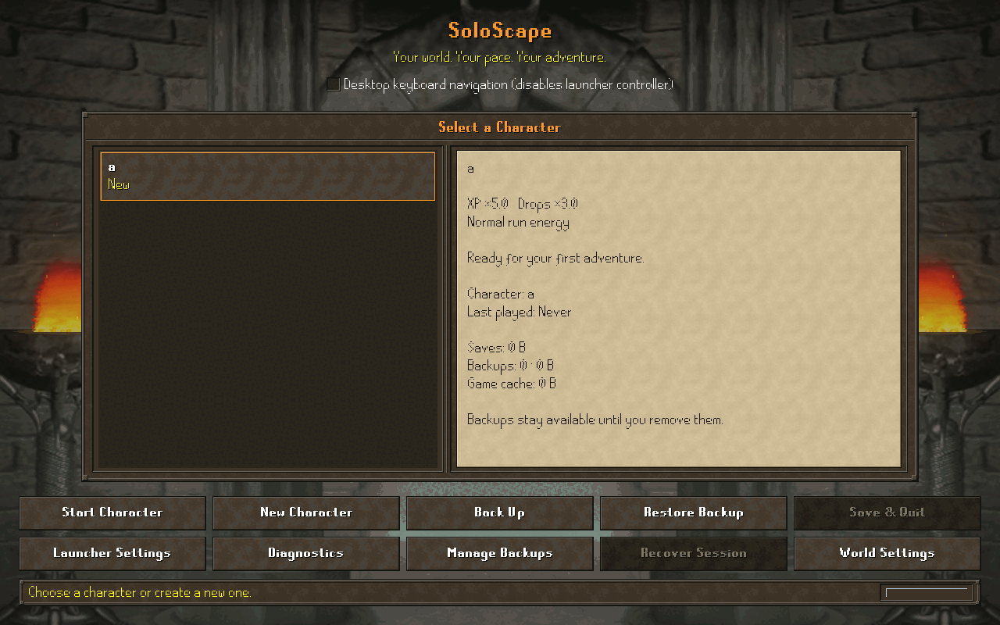
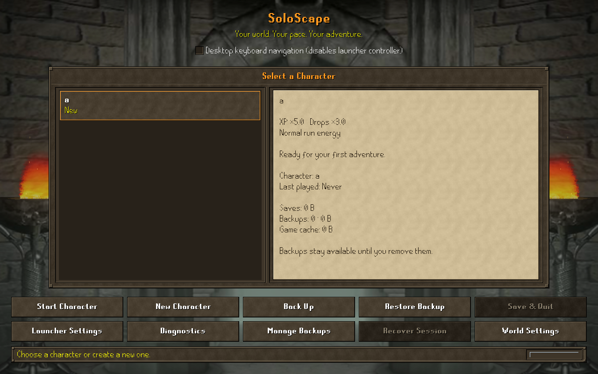

## Reference flame frames and heavier launcher text

Owner feedback found the procedural flame silhouette/scale and thin body font still missed the original login scene. Client patch `0049-reference-brazier-frames-and-bold-launcher-text.patch` replaces the procedural fire with the owner-supplied eight-frame RS login sheet. It extracts the warm flame pixels at runtime, retains their original RGB and sequence, and excludes the stone backdrop, bowls and corner badges. The source PNG stays private in `.runtime/launcher-art/brazier-flames.png` and ships only in the private owner-to-Deck snapshot.

The reference bowl lip (49 px) aligns with the original scene lip (96 px), so flame height/width scale uniformly relative to the bowl. Mirroring and resizing follow the existing scene, with the right flame four frames out of phase. The 30 Hz visibility/gameplay timer displays each source frame for three ticks. The character frame has wider side insets so it no longer covers most of the flames. Missing/invalid reference art leaves the static scene without a flame timer.

Supporting text now uses the existing **RuneScape bold face at 22 px**, including character status, parchment details, subtitle, status and dialogs. The title/button styles remain unchanged. The actual 1280×800 capture below was checked for complete flame visibility, stronger glyph strokes and wrapped detail text.

The matched client jar builds; the exported client stack reproduces all 138 modified/patched files. The real Swing launcher/backend probe verifies eight loaded reference frames, animated visibility, pause/resume/disposal, mapped navigation, name entry and world-rate persistence. The final host paint check averages **6.30 ms** over 100 paints; this is private host/Xvfb evidence, not Deck scanout FPS or physical input acceptance. [Aggregate result](evidence/launcher-reference-flames.json).

To install the owner's sheet on another private checkout:

```bash
python3 scripts/setup_launcher_art.py --spritesheet /path/to/640x480-brazier-sheet.png
```

The private exporter and launcher fixture copy both art files. No standalone supplied sheet is committed; the published images are complete launcher captures with disposable character data.

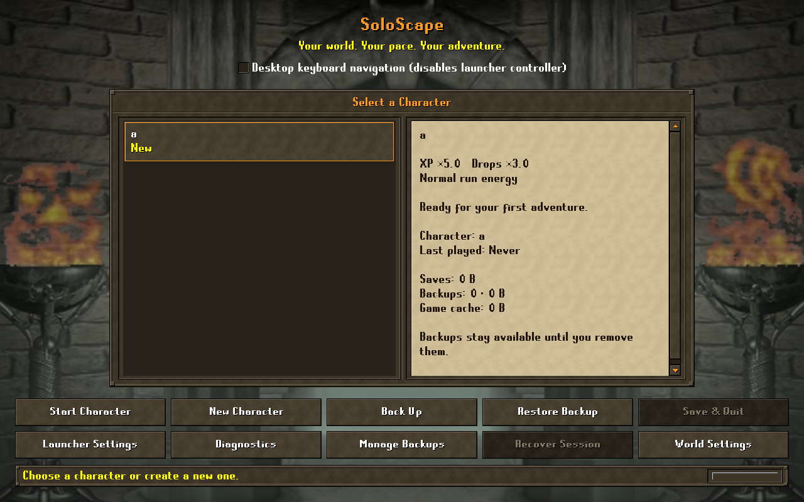


## Stable reference alignment and slower playback

The supplied atlas panels do not share the same scene origin: static-bowl registration gives horizontal offsets `0, +1, 0, -6, +1, -1, -2, +10` px, with frame 3 also one pixel higher. Using identical crop coordinates made the fire jump sideways. Client patch `0050-align-reference-flames-and-halve-speed.patch` normalizes each frame against its stationary bowl before extracting the flames. A larger 80×90 crop retains the tall flame tips. The normalized rim maps to the original backdrop's measured rim at `(49,265)`, spanning `x=0..98`.

The animation timer changes from 33 to **66 ms**, retaining three ticks per source frame: each pose lasts approximately **198 ms**, twice its previous duration. This halves playback speed. The heavier RuneScape supporting text remains in place.

The jar builds and all 138 client modified/patched files reproduce. The native launcher/backend checks pass frame loading, timer visibility, pause/resume/disposal, controller navigation, entry guards and world settings. Every pose was rendered through the actual Swing scene at 1280×800 with a controlled fixture clock and visually checked for bowl contact. The GIF below displays those eight poses for 200 ms each; it is a presentation fixture, not a physical controller or Deck FPS test. [Host evidence](evidence/launcher-aligned-flames.json).

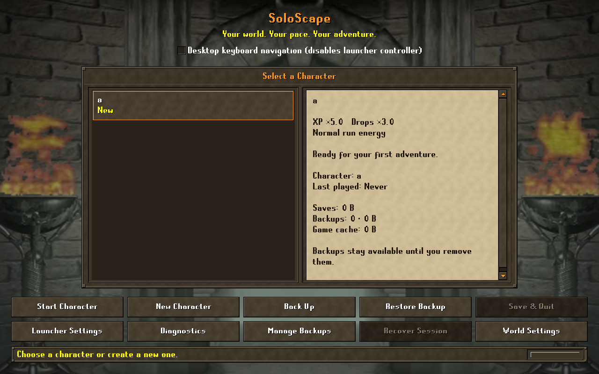
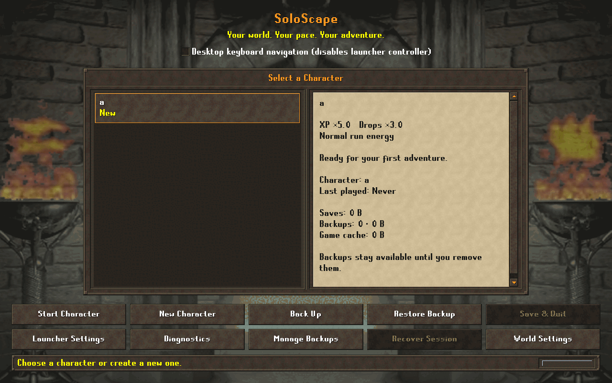
