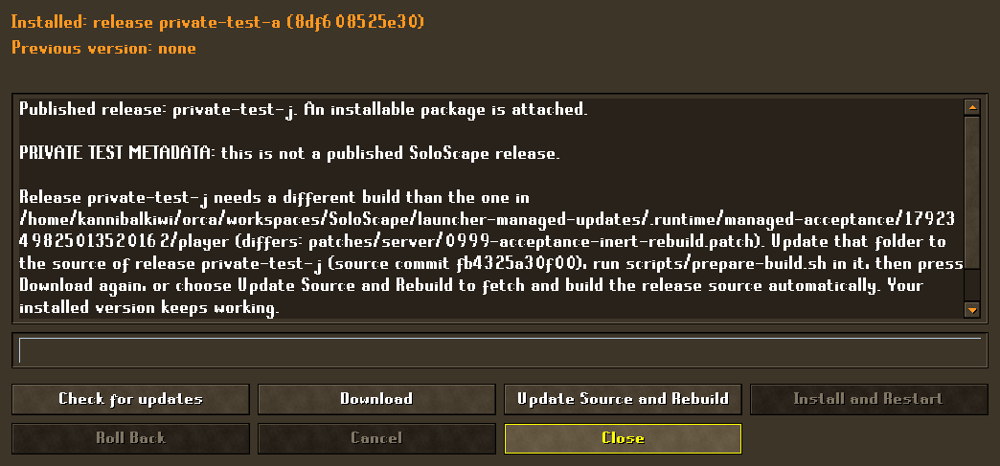
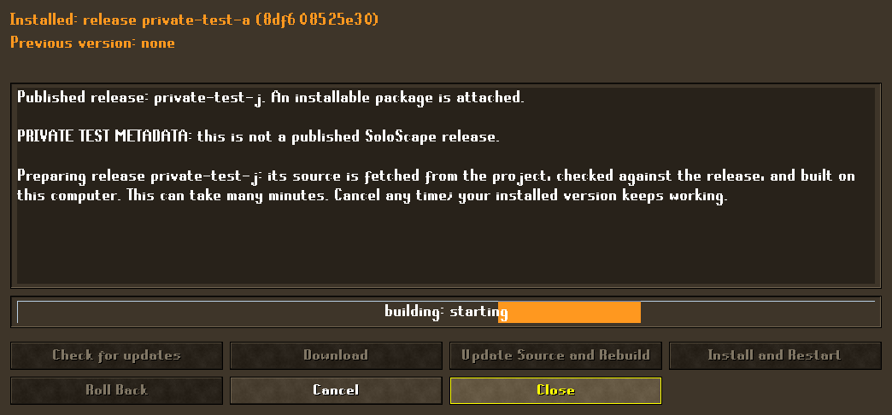
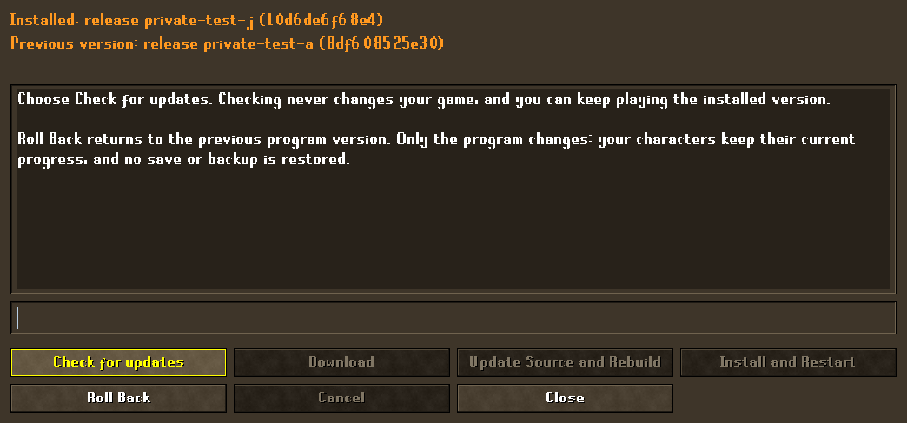
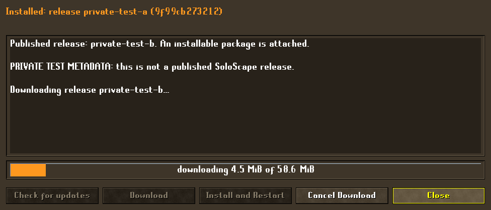
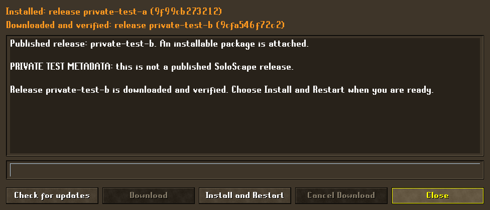

# Managed updater — 18 October 2026

The graphical launcher can now check for, download, verify and install a SoloScape update into a **managed install**, then continue the same characters in the new version. This is the smallest usable production path, built from the merged lab mechanisms. It is verified privately; **no public release exists, nothing was published, and no owner install, Deck or profile was touched.** See [limits](#limits-and-open-questions) before relying on it.

## What a player sees

Launcher Settings → **Updates…** opens one dialog (Settings is its owner, the launcher window its owner's owner):

- **Installed:** release label and the first 12 characters of the version id. **Downloaded and verified:** the staged candidate, if any, with its own label and id.
- **Check for updates** reads the fixed project's latest stable release. Offline, rate-limited, no-release and no-package outcomes are plain messages; the installed version stays usable. There is **no network access at launcher startup**.
- **Download** streams the one declared package with a progress bar (stage, MiB done of total). **Cancel Download** stops it and removes every partial file. A whole-job time limit (30 minutes) applies on top of the socket timeout, so a trickling server cannot hold it open.
- **Install and Restart** is enabled only for a verified staged candidate with no world running and no download in flight. It records a single-use request and quits the launcher with exit status 75. The bootstrap then applies the update and relaunches.
- B (mapped) closes only the top dialog and restores its parent's focus; closing the dialog never cancels a download. The result of the last apply (installed, refused, or rolled back) appears once at the next launch.

A source/development checkout shows the same dialog but explains that it cannot install; Check still works.

## Install layout

A managed install is one folder, separate from the external profile, cache and launcher-settings homes:

```text
install/
  install.json            absolute external profile / cache / launcher homes (+ optional java paths)
  install.guard           the one lock file
  active.json             {current, previous} version ids, replaced atomically
  versions/<id>/          sealed read-only payload; <id> = SHA-256 of its soloscape-runtime.json bytes
  staging/                downloads and extraction scratch (single-writer lock)
  bootstrap/              managed_install.py, runtime_manifest.py, update_package.py (trusted outer; not version-owned)
  candidate.json          the staged, not yet installed candidate (kept by pruning)
  update-request.json     single-use consent from a stopped launcher
  trial.json, last-update.json
```

`python3 install/bootstrap/managed_install.py run install` is the entry point: it takes a **shared** lease on `install.guard`, resolves `active.json` only after the lease is held, verifies that version against its manifest, and launches `scripts/launcher.sh` with the lease descriptor inherited plus `SOLOSCAPE_MANAGED_ROOT` and the three external homes. Other commands: `init`, `status`, `activate`, `rollback`.

The payload keeps the prebuilt hierarchical layout (`upstream/...`, `scripts/...`); nothing is flattened and no gameplay code changed. Profiles, backups, `launcher-settings.json`, the supplied cache and per-version recovery contexts stay outside every version directory.

## Package and manifest (format 2)

A package is a ZIP of exactly `soloscape-runtime.json` plus the files it lists, at their payload paths. Format 2 extends the prebuilt format-1 manifest with `release` (a short label) and `storage_versions` (the sorted list of logical save-storage versions this payload can read, e.g. `[0, 1]`). Limits: archive 768 MiB; 512 MiB per file; 2 GiB and 10 000 files in total; 4 MiB manifest. They are validated before and after extraction; unlisted, linked, special-file, traversal, `cache`/`saves`/`.git`-style, duplicate, encrypted, size-lying and digest-lying entries are refused. Modes come from the installer (scripts/launcher.sh `0555`, everything else `0444`), never from the archive.

The historical format-1 manifest, the staging lab (8 MiB / 4 MiB / 16 MiB bounds) and the activation lab (flat 1 MiB files) stay unchanged for their own tests. `scripts/runtime_manifest.py`, `update_package.py` and `managed_install.py` are the production adaptations.

## Locally supplied files

A package need not carry the game programs. A manifest entry written `{"supply": "local"}` (no digest, no bytes in the ZIP) is allowed only for the server jar, the client jar and server data files; the runtime scripts and `launcher.sh` must always be released and hashed. The intent: a player builds SoloScape from source once, and later releases ship only scripts plus the pins and patch hashes that build must match. See [the content classification](RELEASE_CONTENT_CLASSIFICATION_20261018.md) for what each group is and which questions stay open.

- **Registration:** `managed_install.py init … --supply-root <built source folder>` (up to four) or `managed_install.py supply-root <install> <folder>…`, which needs the exclusive lease. They are kept in `install.json`, which only the bootstrap writes.
- **Acceptance of a build:** at download time the first registered folder whose `.runtime/build-stamp.json` has exactly the manifest's `pins` and `patches` and whose jars still hash to that record is used. Otherwise nothing is staged and the player is told to update the source folder and rebuild, or to register one. Each local file is opened without following any link, must be an ordinary file under 512 MiB, and is copied with cancellation and the whole-job deadline; a file that grows or changes while copying is refused.
- **Result:** the copies land in the new version at their hierarchical paths and `supplied.json` records their sizes and SHA-256. The sealed version is then complete and independent of the source folder; validation, activation, rollback, pruning and the launch-time check are unchanged and re-verify it.
- **Trust:** a locally supplied file is trusted exactly as far as the player's own build is. The manifest pins its path and the source it must come from, not its bytes, because the jars are not reproducible across builds. `supplied.json` catches accidental damage and a mismatch with the recorded copy; it does not stop a user who can write to the install. A digest still proves only that the scripts are what GitHub listed.
- **Limits:** the updater never builds. A release that changes a patch or pin needs a local rebuild first and is refused with a plain message until then (see [what a scripts-only release can deliver](#what-a-scripts-only-release-can-and-cannot-deliver)). An update that only changes scripts installs by itself.

## Adopting an existing install, and what an update keeps

`managed_install.py init <install> --package <zip> --sha256 <digest> --adopt <old source or Deck install> --launcher-home <new folder>` makes the first managed install around an existing source or Deck-export install **without moving or rewriting any of its state**. Nothing is written to the old tree; profiles are referenced where they are.

| State | What happens | Why |
| --- | --- | --- |
| Profiles: saves, `.soloscape-account-save` journals, death-loot world file, backups, `session-logs`, `client-home` (client preferences), `login.json` | Referenced in place (`profile_home` in `install.json`). Never copied, moved, repaired or rewritten, by adoption, update, rollback or pruning. | A same-device upgrade must keep the remembered login and native account exactly as they are. |
| Remembered login | Classified only (`remembered` / `empty` / `missing` / `unreadable`) and shown by `status` and the adoption report. An empty password stays empty. No password or account name is read out, logged or copied. | A cross-device save import (`save_sync`) deliberately leaves `login.json` empty; the updater must not "fix" that by inventing a password, and must say so plainly. |
| Cache and JDKs | `cache_home`, `server_java`, `client_java` in `install.json` point at the old install's paths, taken from its `config/local.env` (read as data, never executed) or its defaults. Nothing is copied or redistributed. | The cache and JDKs are supplied by the player. |
| `launcher-settings.json` and `launcher-art/` | Copied (never overwritten, links refused) into a separate launcher home, because the old launcher home sits inside the old tree beside the profiles. An old launcher home that is already separate is used in place. | The managed runtime requires distinct, non-nested profile, cache and launcher folders. |
| Optional artwork (`brazier.jpg`, `brazier-flames.png`) | Absence is reported by name with where to put the files; it never blocks adoption or an update, and an update never deletes artwork. `status` shows which files exist. | A new export omitted the braziers; the launcher must say so rather than silently show no scene. |
| Built jars and server data | The old install is registered as a supply root when it holds a build record, so a code-only package can install from it. | See [locally supplied files](#locally-supplied-files). |

Adoption refuses (and leaves no install behind) when any profile has an unresolved session record, is running, or holds a save storage version the first package cannot read, the same gates as an update. Apply and rollback keep refusing while a launcher, an owned world, an orphaned world JVM or an unresolved recovery record holds the install guard; saves are never restored to make a rollback start.

The updater does not import `save_sync` and never reads or writes cross-device save bundles; they are a different mechanism with different secrecy rules (`docs/SAVE_SYNC.md`). After adopting, use only the managed install: the old tree is untouched and still launchable, but two installs sharing one profile home are not coordinated.

## What a scripts-only release can and cannot deliver

The 14 released files are the Python launcher/profile/session/updater scripts and `launcher.sh`. Everything the player sees in the game or the Swing launcher is in the 111 patches (57 client, 54 server) built into the local jars, plus the server data, which are the locally supplied files. So:

- **Installs by itself:** fixes to the launcher backend, profile and backup handling, session recovery, the updater and the bootstrap-visible scripts, with the same pins and patch hashes.
- **Needs the player to rebuild first:** any release that adds or changes a client or server patch, moves a pin, or changes server data. Download refuses it with the folder, the differing patches and `scripts/prepare-build.sh`. The player brings the source folder up to the release (for example with git; the updater never fetches source), runs `managed_install.py rebuild <install>`, and presses Download again. The acceptance below does exactly this on real builds.
- **Practical reading:** with jars unpublishable, almost every gameplay update is a rebuild-then-install. The updater makes that safe and guided (verified, cancellable, pointer-only rollback, saves never touched), but it does not make a Java change arrive automatically. Shipping jars in a release needs the unresolved distribution decisions in [the classification](RELEASE_CONTENT_CLASSIFICATION_20261018.md).
- **Not built:** a launcher button that updates the source folder and rebuilds; fetching source patches from a release; a bootstrap that updates itself.

## Update Source and Rebuild (Java-changing releases)

When Download is refused because the release needs a build the player does not have, the Updates dialog offers **Update Source and Rebuild**. One press runs a single cancellable job on its own worker thread (never inside Save & Quit): download the release package, then

1. **Read the release's declared source identity** from the digest-verified package manifest: the exact `source_commit`, the three upstream `pins`, the hash of every patch file and the hash of every released script *and build entrypoint* (`prepare-build.sh`, `apply-client-patches.sh`, `apply-server-patches.sh`, `apply_client_patches.py`). A release that names no commit (all zeros) cannot be rebuilt. Release notes, tags, titles and URLs in metadata are never executed, followed or used as commands.
2. **Fetch exactly that commit** from the fixed project repository (`https://github.com/kannibalk1w1/SoloScape.git`) into a new isolated workspace under `<install>/builds/`, with the user's and system git configuration ignored, no hooks, `https` only, no submodules and no links. The fetched commit id must equal the declared one.
3. **Verify before building:** the fetched `scripts/local_dev.py` pin list (read as data, never run), the patch hashes and the released-script hashes must reproduce the manifest exactly, or the workspace is deleted unbuilt (`source-mismatch`).
4. **Provision upstream:** each pinned upstream repository is cloned (git objects only, no hardlinks) from a registered source folder that already holds that exact commit, otherwise fetched from its fixed 2011Scape repository, then checked out at the pin.
5. **Build with the project's own `scripts/prepare-build.sh`** using the install's configured JDK 21/JDK 8 and cache, and a private Gradle dependency cache (`<install>/builds/gradle-home`, copied once from a registered folder's `.gradle`, used offline). The build record must match the release's pins and patches.
6. **Stage through the existing verified path:** the finished workspace is used as a supply root for the normal package install, which copies the jars and data into a sealed version and records `candidate.json`. **Install and Restart** then works as for any update.

What it never does: reset, check out, stash, clean or write in the player's source folder (it only reads git objects out of the folder's `upstream/*` clones and copies its Gradle cache once; local edits and untracked files survive, verified byte-for-byte); touch profiles, saves, backups, `login.json`, the cache or JDKs; run anything from metadata; or change the installed version (only the bootstrap switches the pointer, after the launcher exits).

Progress is shown as the stage (`fetching source`, `verifying source`, `building: <current Gradle task>`) on an indeterminate bar, because a build has no known total. **Cancel** stops only the process groups this job started (SIGTERM, then SIGKILL after a grace period) and deletes the partial workspace; closing the launcher or backend does the same, within seconds, and never waits on or interrupts a world's save hooks. Failures (no JDK configured, no dependency cache, source unavailable, source mismatch, build failed with the last output lines and the log path) leave the installed version playable and say what to do; retryable ones keep the button enabled. At most one finished workspace (about 0.5 GB) is kept, plus the private Gradle cache.

**Prerequisites for a first rebuild:** `git` and `bash` on the PATH; JDK 21 and JDK 8 locations in `install.json` (`--server-java`, `--client-java`; `--adopt` takes them from the old install); the authorized cache; internet access to github.com for the source (and to the upstream repositories only when no registered folder already holds a pin); and a registered source folder in which `scripts/prepare-build.sh` has succeeded at least once, which supplies the Gradle dependency cache and the upstream clones. Without that folder the job stops with a plain message instead of attempting an online dependency build.

**What this can and cannot update:** any release whose source commit is reachable in the fixed project repository and builds with the project's scripts and pinned upstreams, including client/server patch changes and pin moves whose commits the upstream repositories still serve. It does not update the JDKs, the cache, the bootstrap, or the Gradle dependency set itself (a release that needs a dependency absent from the private cache fails the offline build and says so). A digest and a commit id are not a publisher signature; GitHub HTTPS for the fixed project is the explicit trust source.

## Roll Back

The Updates dialog shows the installed and the previous version and a **Roll Back** button. It is enabled only with a previous version, no world running and no download/rebuild in flight; when it is not, the dialog states why in plain words (for example *Character Ana has an earlier session that still needs Recover Session in its original version*, or *… uses save storage version 1, which release X cannot read*). Pressing it asks for confirmation (the dialog opens on Cancel; B also declines) and explains that **only the program version changes: characters keep their current progress and no save or backup is restored**. Confirming records a single-use request and exits the launcher with status 75; the bootstrap then takes the exclusive lease and repeats every gate (live or inherited lease, running profile lock, unresolved `session.json`, logical save storage version, payload verification) before moving the pointer back. The old current becomes the new previous, so the move can be undone the same way, and an unresolved session keeps its original version context. A refusal at that point is reported once at the next launch (*Roll back not applied: …*) and the working version keeps running. The launcher never restores a save backup to make a rollback start.

## Update flow

1. **Check** (`release_updates.check`, 4 s socket timeout, 256 KiB bound, no redirects). A release may declare one `soloscape-package-*.zip` asset with `size` and `sha256:` digest, at exactly the fixed project's release-download URL.
2. **Download** on its own thread into a private scratch directory under the install's `staging/`; refuse growth beyond, or an early end before, the declared size; verify the SHA-256; honour cancel and the deadline on every chunk; follow redirects only to GitHub's two object hosts over HTTPS.
3. **Extract and validate** into a scratch directory, re-validate the whole tree with the manifest validator, require `release == tag`, then rename into `versions/<id>` and seal it read-only. An interrupted run leaves only scratch that the next run removes. Nothing runs from a candidate before the bootstrap has verified it.
4. **Install and Restart:** the launcher's advisory pre-check (no running world, no unresolved session records, saves readable by the candidate) writes `update-request.json`; the launcher stops its backend normally and exits 75.
5. **Apply** (bootstrap, no launcher running): acquire the **exclusive** lease without blocking, re-verify the candidate, repeat the checks below, write `trial.json`, publish `active.json` (temp file, fsync, atomic replace, directory fsync), prune versions that are neither current, previous nor the staged candidate, and relaunch.
6. **Trial:** if the new version exits with an error within 60 seconds of its first launch, the bootstrap rolls back (same checks) and relaunches the previous version, and the player sees why.

## Safety gates (all enforced by the bootstrap under the lease)

- **Live holders:** a shared lease held by a launcher, a world's game JVMs (each opens its own description of the guard and inherits it), or any other inherited copy makes apply/rollback fail with *still running*. A running profile lock is refused as well.
- **Unresolved sessions:** any profile with `session.json` blocks apply and rollback. The recorded original version, its context and its processes are kept (versions are not pruned out from under them, because apply cannot succeed while they exist).
- **Save format:** the bootstrap computes each profile's logical storage version from `saves/*.toml` with the pending `.soloscape-account-save` journal overriding canonical files (stdlib only, read-only) and refuses a candidate or rollback target whose `storage_versions` does not list it, an unreadable or inconsistent save, or a storage-version-1 world without its death-loot world file. Content is still fully validated by the version itself at launch.
- **No data movement:** apply and rollback change the pointer only. Nothing is restored, copied, migrated or deleted in profiles, backups, settings or cache, so rollback keeps progress made in the newer version; if the older version cannot read it, rollback is refused instead.

## Trust boundary

The package digest is taken from the same GitHub API response that names the asset. It shows the bytes are what GitHub listed for the release; it does **not** authenticate the publisher. The explicit trust source is GitHub HTTPS for `kannibalk1w1/SoloScape`: anyone who can publish a release there can publish an installable package. Independent signing is a possible later hardening, not required here. Manifest identities (`source_commit`, pins, patch hashes, `cache_revision`) are declared, not verified. The bootstrap is stdlib-only and is **not** updated by an update; changing it needs a reinstall. This is a cooperative single-user protocol, not a sandbox against a hostile local user.

## Evidence

### Tooling tests (original fixtures, production entrypoints)

The root suite passes **471 cases** (one existing optional skip), up from 315; `test_managed_supply.py` (32) covers locally supplied files and rebuild, and `test_managed_migration.py` (22) covers adopting an existing install, login/art/state preservation through update and rollback, and the save_sync boundary, `test_source_build.py` (21) covers source fetch, verification, isolated builds, cancellation and closure cleanup on a local git fixture, and `test_managed_rollback.py` (15) covers the rollback pre-check, request and bootstrap handshake. New files: `test_managed_install.py` (26), `test_update_package.py` (17), `test_update_manager.py` (13), `test_managed_runtime.py` (4) and one backend test for guard inheritance. All bytes are synthetic and labelled TEST; real-sized cases use 60 MiB random data. They cover:

- **Good update:** first install; stage; request; the bootstrap's `run` loop applies it and launches the new version with the external homes; saves untouched; old and new versions retained, third version pruned. CLI `init/status/activate/rollback` through the installed bootstrap copy.
- **No release / offline / no package / same label:** nothing is downloaded or changed; the installed version stays usable.
- **Corrupt, interrupted, hostile:** wrong or truncated or oversized or empty download, broken socket, HTTP error, lying digest/size, traversal, unlisted/missing files, `cache`/`.git` paths, format 1 manifest, symlink, FIFO and directory entries, duplicates, encryption, an inflated entry, a FIFO or link as the archive, a symlinked staging folder, a second staging run, leftovers of an interrupted run. None leaves a version, partial file or pointer change.
- **Bounds:** 60 MiB files install; cancel at start and during a blocked read (including a cancel racing the end of a read); a trickling server hits the whole-job deadline; closing the backend stops a download within two seconds.
- **Refusals:** unresolved session record, running profile lock, held lease, a lease inherited by an orphan after its parent closed, tampered candidate or current version, already-installed version, candidate that cannot read the logical save version (including a pending journal that overrides the canonical file), storage version 1 without a world file, damaged or non-integer saves, and a rollback target that cannot read newer saves. Refusals leave pointer and saves unchanged.
- **Crash recovery:** a forced process exit before and after the atomic pointer replacement leaves a parseable old or new pointer; the next run clears temp files and a stale trial record, and the new version stays rollback-able. A new version that dies at once is rolled back automatically unless the save format forbids it. A leftover request is single-use.
- **Rollback keeps newer progress:** bytes written in the newer version are still there after rollback.
- **Real backend over its stdio protocol:** managed identity, staged candidate, apply request, orphan-session refusal; owned game JVMs hold their own copy of the install guard.

### Private native acceptance

`experiments/managed-updater/acceptance.py` (see its [README](../experiments/managed-updater/README.md)) drove the **real** bootstrap, graphical launcher, native server (patch stack 54) and native client (stack 57) on an owned Xvfb display with mapped keyboard input, a disposable profile and copied cache, and two private packages. Two rounds are recorded: the first used two full 58.6 MiB packages built from the immutable 54/56 deck-export snapshot; the current one uses **code-only packages of about 87 KiB** (scripts, pins and patch hashes) plus a private stand-in build folder holding the snapshot's server jar and data, this checkout's built client jar and a matching build record, registered at `init` and used by the Download step for the 61 MB of jars and data. In this round the build record is synthesized from the snapshot rather than produced by a Gradle rebuild; round 3 replaces it with real `prepare-build.sh` output. GitHub was replaced only at the backend's two network seams, with metadata labelled *PRIVATE TEST METADATA*. Sequence and result for either round (all checks true, [sanitized evidence](evidence/managed-updater-20261018.json)):

1. Install `private-test-a`; create a character through the real backend; **Start Character** logs in and saves (account `storage_version = 1`, native capabilities verified); stopped-world account fields recorded.
2. Updates dialog (A opens Settings, directional input to **Updates…**, A): identity shown; **Check** (A); B closes only the nested dialog and restores Settings focus, B returns to the launcher; reopen.
3. **Download** with progress; **Cancel Download** leaves no partial file or version; **Download** again to a verified staged candidate; while the launcher runs, activation is refused.
4. **Install and Restart**: the launcher exits 75, the bootstrap applies `private-test-b` under the exclusive lease, the relaunched launcher shows *Updated. Your characters, backups and settings were kept.* once.
5. **Continue** in `private-test-b` on the same world: compared account fields (name, experience, inventories, tile, storage version) equal; second native session verified.
6. A `private-test-c` candidate that only reads storage version 0 is staged and **refused** with the saves untouched. `rollback` returns the pointer to `private-test-a`; **Continue** there works with equal fields.
7. Six verified backups remain valid; the cache inventory is unchanged; both version payloads verify; two distinct version contexts exist; no staging leftovers.

#### Round 3: real `prepare-build.sh` builds and a Java-changing release

`acceptance.py --real-checkout` removes the synthesized build record. It copies this checkout's sources (no build outputs, no cache, no profiles) into a disposable **player folder** and runs the project's own `scripts/prepare-build.sh` there, so the jars, server data and `.runtime/build-stamp.json` the updater consumes are genuine; the Gradle user cache is shared with this worktree and JDKs and cache are read-only inputs. Then, on the same real native stack (server 54 / client 57, mapped keys on Xvfb):

1. Code-only packages `private-test-a` and `-b` (about 90 KB) are built by `package_builder.py --checkout`, A is installed with the player folder registered, and the sequence of rounds 1–2 above runs (play, Check, B ancestry, cancel, Download, refusal while running, Install and Restart, Continue after update, save-incompatible candidate refused, rollback, Continue).
2. **A Java-changing release.** A disposable **maintainer folder** adds an inert server patch (`0999-acceptance-inert-rebuild.patch`, one comment line), is built by the real `prepare-build.sh`, and `package_builder.py --checkout` produces release `private-test-j` from it. The production `UpdateManager` is offered `j`: Download is **refused** with *"Release private-test-j needs a different build than the one in …/player (differs: patches/server/0999-acceptance-inert-rebuild.patch). Update that folder to the source of release private-test-j (source commit …), run scripts/prepare-build.sh in it, then press Download again. Your installed version keeps working."*, status `needs_build = needs-rebuild`, with the install, pointer and staged candidate untouched.
3. The player folder gets the patch (standing in for pulling the source) and `managed_install.py rebuild` runs the real `prepare-build.sh`; Download then stages `j` with the player's own new jars (the version's server jar hash equals the player's new build record and differs from the first build); the pointer moves; **Continue** works on the same character (account fields equal); the superseded `private-test-b` is pruned and only current and previous remain.
4. Throughout: `login.json` is byte-identical, the generated password appears nowhere in the install root, launcher home, probe output or bootstrap log, and the launcher runs without the optional braziers (none are present) while `status` reports which are missing.

Observed jar hashes (first 16 hex digits): player first build server `ba1d3c5eb9c71a2e`, client `8c5f7f3f298deb59`; after the rebuild, player server `68734009827f237b`, client `8c5f7f3f298deb59`; maintainer server `68734009827f237b`, client `ab5f47e70dd1c120`. Same source, same machine, different folders: the server jar reproduced, the client jar did not.

Five complete attempts were made: two failed on harness matters and three passed. The first passed every product check but failed in my end-of-run bookkeeping (it re-verified a version that had correctly been pruned); the third failed because the fake transfer completed before the scripted controller navigation reached **Cancel Download** (the 90 KB package downloads in seconds, so the fake is now throttled to about 30 s). The second passed with the earlier throttle; the fourth and fifth, on the final harness, passed all 37 checks.

#### Round 4: launcher-driven Java-changing update and user-triggered rollback

`experiments/managed-updater/rebuild_acceptance.py` drives the new buttons through the real graphical launcher (mapped keys on Xvfb), the real bootstrap, the real native server 54 / client 58 stack and **real `scripts/prepare-build.sh` builds** in disposable folders:

1. A disposable **player folder** is built by the real prepare flow and release `a` (about 100 KB, scripts only) is installed from it.
2. A disposable local **git repository** stands in for the fixed project repository (only this process's acceptance shim points the fixed origin at it; production has no override). It holds this checkout's tracked sources plus one inert server patch. A disposable **maintainer folder** cloned from it is built by the real prepare flow, and `package_builder.py --checkout` produces release `j`, which declares that exact commit.
3. In the launcher: play a world; **Check**; **Download** is refused with the needs-a-different-build message that names the differing patch and points at the button; **Update Source and Rebuild** runs (isolated workspace, owned build processes, indeterminate bar, Cancel the only active control); **Cancel** mid-build: every owned process is gone, no workspace or version is left, the dependency cache is kept and the launcher is still running; the rebuild runs again to completion and stages `j`, whose version carries the launcher-built jars of the declared commit; **Install and Restart**; **Continue** in `j` (account fields equal, native session verified); the dialog shows the previous version; **Roll Back** is declined with B (nothing changes), then confirmed from the safe default (the confirmation says no save or backup is restored); the bootstrap rolls back; **Continue** again with byte-identical saves, and the version rolled back from is now the previous one.
4. Throughout: the player's source folder is byte-identical before and after (rebuild and cancel); `login.json` is byte-identical and the generated password appears nowhere in the install root, launcher home, probe output, build log or bootstrap log; the launcher ran without the optional braziers; backups are valid; the cache is unchanged; only current and previous versions remain and each launched version has its own context.

Two complete passes on the final code (36 checks each): one fully fresh (all three real builds), one reusing the first run's real player and maintainer builds. Observed jar hashes (first 16 hex digits, fresh run): player first build server `ba1d3c5eb9c71a2e`; maintainer server `68734009827f237b`; launcher rebuild server `68734009827f237b` (the same source reproduced the server jar twice more), clients `a29676a6dca3fdd9`, `82d5c7a15a949c27` and `dbf2f1fd00137110` (three builds of one source, three client jars). Five earlier attempts failed on harness or latent-tooling defects, found only because the build was real: a maintainer folder with no JDK configuration; a nested Swing call and unsafe repeated key presses in the new probe; a fake download throttle that outlasted the scripted navigation; **a latent bug in `apply_client_patches.py`** (when its scratch folder sat inside a git checkout, `git apply` skipped every patch and the script reported all of them already applied, so a clean tree was never patched; fixed with a regression test); and one lost navigation press on the rollback confirmation. **Not exercised:** the real github.com SoloScape repository and the 2011Scape upstream remotes (the upstream pins came from the registered folder), SDL/Steam Input/hardware, audio, power loss, and anything on an owner install.








The same controller-modal ownership check (`scripts/harness/NativeLauncherUpdateProbe.java`, run by `scripts/smoke-launcher.py --updates`) covers a source copy: A opens Settings and Updates, notes stay plain text, the dialog explains that a source copy cannot install, nested B restores the parent, and a late check response never reopens a cancelled dialog. It passed 15 of 15 runs after lengthening the synthetic key hold (it had failed about one run in four before). The managed acceptance needed four earlier attempts before passing, each a harness or orchestration defect fixed in the tooling rather than the product: a `python3` PATH shim that also intercepted `python3 -c`, launcher focus after the game window closed on a display with no window manager, a lost synthetic navigation press, and a bookkeeping assertion about the one-time apply result. The final harness then passed on consecutive runs, the last on the committed code. This is **synthetic AWT key input mapped to controller actions, not SDL, Steam Input or hardware**.

Client patch stack 0001–0057 applies cleanly to a fresh clone of the pinned client and reproduces the built tree exactly (`scripts/verify_patches.py client` matches all modified files).

## Limits and open questions

- **Packaging and licensing are unresolved.** Full packages made by `package_builder.py --payload` / `experiments/managed-updater/build_packages.py` from a deck export contain the owner's authorized cache-free game data and jars and are **private test inputs, not releasable**. A code-only package (`package_builder.py --checkout`) contains only this project's scripts, so the items below gate it far less; see [the classification](RELEASE_CONTENT_CLASSIFICATION_20261018.md). The repository's own code is MIT licensed (`LICENSE`). The [runtime/notice inventory](RUNTIME_NOTICE_INVENTORY_20261017.md) still lists three unattributed local client jars (`clientlibs.jar`, `graphics.jar`, `trident-1.5.00.jar`), 52 server and 17 client artifacts with no detected notice file, embedded native libraries, inherited game/client/server-data provenance, and the separately supplied JDK/Python/font/art/cache inputs. Nobody has decided what a public package may contain. This blocks publishing, not the updater.
- **No public release has been published.** Fetching from real GitHub is covered by fake-transport tests and a native run whose GitHub seams are replaced; the live check still returns no public release.
- **First install** is `managed_install.py init` from a local package zip plus its digest (optionally `--adopt` an existing install). There is no graphical first-run installer, no Windows/macOS support (Linux x86_64, `flock`, `/proc`), and the owner's existing source/Deck install is not migrated.
- **Adopted state stays in the old tree.** `--adopt` references the old install's profiles and cache where they are (nothing is moved), so deleting that tree deletes the saves, and two installs sharing one profile home are not coordinated. A move-and-verify migration would be a separate, explicit step; it is not built. Adoption was exercised on disposable fixtures only, never on the owner's Deck or a real Deck export.
- **Rollback** is a **Roll Back** button in the Updates dialog (confirmed, gated and restart-handshaken), `managed_install.py rollback`, or the automatic first-launch trial.
- The bootstrap's own code, Java 8/21 runtimes, the supplied cache and the Gradle dependency set are not updated by this path. A release needing a dependency absent from the private cache fails its offline build with a plain message.
- **Update Source and Rebuild** needs the prerequisites listed in its section (git, bash, JDKs in `install.json`, a registered folder with one successful `prepare-build.sh`, github.com access) and about 0.5 GB for the kept workspace plus the Gradle cache copy. It was proven against a disposable local git repository, not the live project repository, because no release exists.
- Physical Deck, SDL controller, Steam Gaming Mode and audio acceptance were not run; the native probe uses synthetic AWT key events on a private Xvfb display.
- Disk-full and power-loss behaviour is not proven. The fsync/atomic-replace sequence and process-kill cut tests model a crashed coordinator only.
- Concurrent installs sharing profiles but not an install guard are not coordinated.
