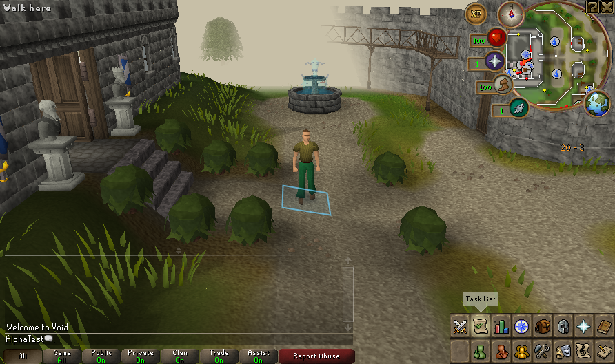

# Native test build ready — 17 October 2026

A private native test snapshot is prepared from merged`main` commit`dcd4b7a38f91df90e34091c8fe8b57fe7a741247`, server patch46/client patch56. All10,853 manifest entries verify. Both source exports match (93 server/140 client files), and the matched jar stamp verifies. The snapshot includes the native fixes through PR74; draft WASM and the experimental Lab token are separate.

Private local build: `.runtime/deck-exports/1792270751691129262`. This export includes separately supplied cache/art and local JDKs for owner testing. **Do not upload it to GitHub Releases.** Owner Deck deployment/save transfer and release publishing remain held.

## Fresh exported-build check

The copied build itself runs real native New, in-game Save & Quit, and Continue using an original fresh AlphaTest profile. The in-game first quit press opens confirmation; the confirmed action requests normal shutdown. A later startup cancellation preserves the entire saved world. All five generated fixture backups validate. Normal native primary-save confirmation and post-stop verification remain required by the session backend.

| Host observation | New | Continue |
| --- | ---: | ---: |
| Complete session, including startup/readiness/save | 23.338 s | 24.144 s |
| Peak sampled server RSS | 1,486,340 KiB | 1,315,956 KiB |
| Peak sampled client RSS | 1,298,836 KiB | 1,556,232 KiB |
| Peak simultaneous sampled JVM RSS | 2,775,440 KiB | 2,872,188 KiB |

These0.5-second samples include startup/JIT/cache work on the development host. They are not steady-state memory, Deck limits, FPS, frame tails or a comparison against WASM. The screenshot is the native window on an owned Xvfb display, software rendering; audio was disabled with a private empty ALSA configuration. Native session instrumentation compiles separately; no jar was changed. No physical pad, Gamescope, suspend or battery acceptance is added. [Sanitized build/run evidence](evidence/native-test-build-20261017.json).

The copied build's local JDK selectors are configured. From that directory, `bash scripts/deck-launch.sh` starts its graphical launcher on a suitable desktop. This is a source-build testing snapshot with its own runtime paths, not a managed installer or a clean-machine release. Keep it separate from existing owner profiles until deployment is explicitly resumed.

## Work represented by this native line

Recent merged changes include Dungeoneering room rotation/exit/reward handling, native primary-save confirmation, production cancellation recovery, familiar/Slayer ownership and stale-entity protection, transactional floor pickup, grave identity/lifecycle fixes, retained failed offline saves, independent captured variable lists, gravestone purchase authority and connected Summoning ingredient death/Take coverage. Dated reports retain their exact fixtures and limits; this smoke does not retest every feature or quest.

The updater now has optional external state/cache/launcher locations, bounded release discovery, a private prebuilt runtime/lifecycle contract and separate staging/activation labs. It is not yet an installed GitHub updater. Unrecovered grave/floor persistence across a stopped world remains a P1; see the [pause-while-closed plan](GRAVE_PAUSE_PERSISTENCE_PLAN.md). Next physical acceptance should focus on the current controller corner movement, inventory/loot/shops, Save & Quit/Continue and lifecycle boundaries on a disposable Deck world.
