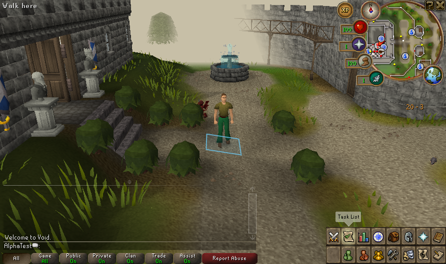

# Native 48/56 test build — 17 October 2026

A fresh private snapshot from merged `main` commit `d2bccb2f00589e1b0442435298ef201560b20201` is ready with server patch **48** and client patch **56**. It includes the [protected charge-preservation fix](KEPT_ITEM_CHARGES_20261017.md) and [connected Summoning supply check](CONNECTED_SUMMONING_SUPPLIES_20261017.md). All **10,870** snapshot manifest entries verify; the source exports match 96 server / 140 client files. Matched jar preparation and the tested/packaged PlayerDeath class comparison pass.

Local build: `.runtime/deck-exports/1792273813506958042`. From that directory, `bash scripts/deck-launch.sh` opens the graphical launcher on a suitable desktop; local JDK selectors are configured. This is a development test snapshot with separately supplied private data and source metadata, not a public installer. Do not upload the payload to GitHub Releases. No Deck installation or owner save transfer occurred.

## Fresh copied-build result

Actual native New, in-game Save & Quit and Continue pass using a fresh original AlphaTest profile. The first quit press requires confirmation; the confirmed action requests normal shutdown. A later startup cancellation preserves the entire saved world. All five generated fixture backups validate. The earlier [46/56 report](NATIVE_TEST_BUILD_20261017.md) remains historical evidence.

| Host observation | New | Continue |
| --- | ---: | ---: |
| Complete session including readiness dwell and saving | 23.866 s | 23.887 s |
| Peak sampled server RSS | 1,471,944 KiB | 1,332,228 KiB |
| Peak sampled client RSS | 1,222,592 KiB | 1,539,024 KiB |
| Peak simultaneous sampled JVM RSS | 2,684,036 KiB | 2,870,732 KiB |

Resources are sampled every 0.5 seconds during cold JVM startup, cache work, readiness and shutdown on the development host. These totals are not startup-only timings, steady-state memory, Deck frame rates, battery measurements or a before/after performance comparison. The private display uses software rendering; audio is excluded through a private empty ALSA configuration. Native session instrumentation compiles outside the unchanged jars. This smoke does not exercise the charge-loss scenario; its dedicated native death/degradation suites are recorded in the fix report.

[Sanitized snapshot, session, resource and screenshot evidence](evidence/native-test-build-48-20261017.json). The actual server hash is `78cb090da0bc7fb3165c01423f9a0b137187ec9e85ebfe8b6443789578343c5c`; the client remains byte-identical to 46/56. Draft WASM and the isolated Lab token are not enabled in gameplay.

Next human acceptance should use a disposable world for protected charged equipment, loot/inventory controls, precision corner movement and Save & Quit/Continue on Deck. Physical input, Gaming Mode, audio and suspend remain open; [unrecovered grave/floor persistence](GRAVE_PAUSE_PERSISTENCE_PLAN.md) is still a P1. Owner deployment and release publishing remain held.
