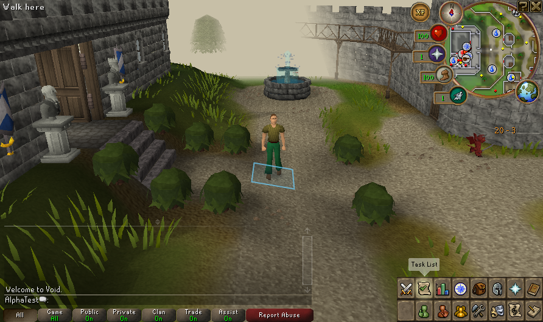

# Native 50/56 test build — 17 October 2026

A fresh private snapshot from merged `main` commit `2c1922647432a59feeaaec3674066ad14150aa4b` is ready with server patch **50** and client patch **56**. It includes the [identical-item protection correction](IDENTICAL_KEPT_ITEMS_20261017.md) and [charged death-drop recovery correction](DEATH_DROP_CHARGES_20261017.md). All **10,881** listed snapshot entries verify after the session; source exports match 99 server / 140 client files. Matched preparation and tested/packaged class comparisons pass.

Local build: `.runtime/deck-exports/1792275179695548410`. From that directory, `bash scripts/deck-launch.sh` opens the graphical launcher on a suitable desktop; local JDK selectors are configured. This is a private development snapshot with separately supplied data and runtimes, not a public installer. Do not upload its payload to GitHub Releases. No Deck installation or owner save transfer occurred.

## Actual copied-build validation

New, in-game Save & Quit and Continue pass with a fresh original AlphaTest profile. The first quit press requires confirmation; confirmed quit requests normal shutdown. A subsequent startup cancellation preserves the entire saved world. All **five** generated fixture backups independently validate. The [48/56 report](NATIVE_TEST_BUILD_48_20261017.md) remains historical evidence.

| Host observation | New | Continue |
| --- | ---: | ---: |
| Complete session including readiness dwell and saving | 23.796 s | 23.418 s |
| Peak sampled server RSS | 1,599,260 KiB | 1,205,652 KiB |
| Peak sampled client RSS | 1,229,708 KiB | 1,521,824 KiB |
| Peak simultaneous sampled JVM RSS | 2,828,240 KiB | 2,719,712 KiB |

Resources are sampled every 0.5 seconds during cold JVM/cache work, readiness and shutdown on the development host. Session totals are not startup-only timings, steady-state memory, Deck frame rates, battery measurements or a before/after comparison. The owned private display uses software rendering; a private empty ALSA configuration excludes audio. Native instrumentation compiles outside the unchanged jars. The separate native death suites exercise the corrected protection/recovery paths; this smoke checks the exported build's session lifecycle.

[Sanitized manifest, lifecycle, resource and screenshot evidence](evidence/native-test-build-50-20261017.json). Actual server SHA-256: `3fc9085053ebb539aedc7274e3873fc7b2c7cb20cec17fed57d19398c4a97f2d`. Client bytes remain unchanged. Draft WASM and the isolated Lab token are not enabled in gameplay.

Next physical acceptance should use a disposable world for duplicate-item protection, charged death-loot recovery, inventory-full refusal, precision corner movement and Save & Quit/Continue on Deck. Physical input, Gaming Mode, audio and suspend remain open. The [unrecovered grave/floor persistence P1](GRAVE_PAUSE_PERSISTENCE_PLAN.md) remains open; these fixes do not make graves durable across restart. Owner deployment and release publishing remain held.
