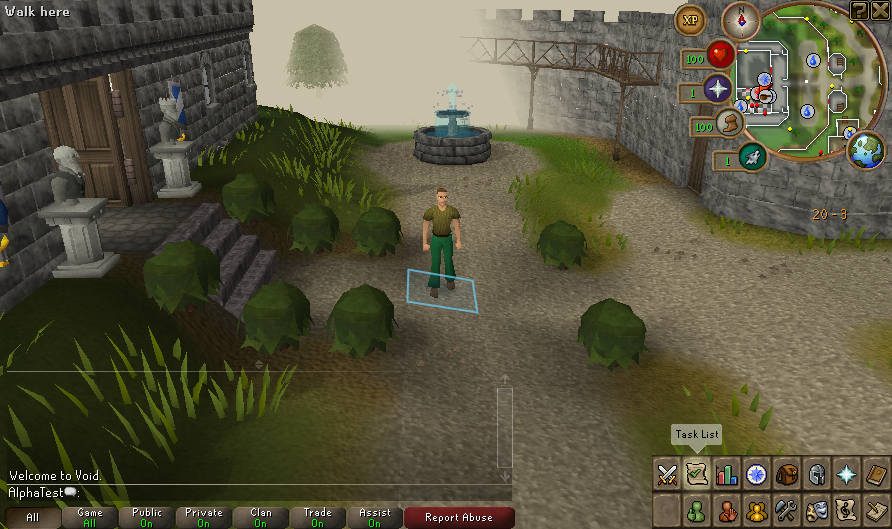

# Native 51/56 test build — 17 October 2026

A fresh private snapshot from merged `main` commit `79e5b3ea89099f1c604c676ad005c1b187a4042a` is ready with server patch **51** and client patch **56**. It includes the [native grave degradation and expiry fixes](GRAVESTONE_TIMER_20261017.md), in addition to the earlier item-protection and charged-loot corrections. All **10,888** listed entries still verify after the native session. Matched preparation and packaged-class comparisons pass; source exports match 100 server /140 client files.

Local build: `.runtime/deck-exports/1792275936705945374`. Run `bash scripts/deck-launch.sh` from that directory on a suitable desktop; its local JDK selectors are configured. The payload contains separately supplied assets/runtimes and must remain private. No Deck installation, owner save transfer or public release occurred. The [50/56 report](NATIVE_TEST_BUILD_50_20261017.md) remains historical evidence.

## Actual copied-build check

A fresh original AlphaTest profile passes New, confirmed in-game Save & Quit, Continue and startup cancellation. The first quit press requires confirmation. Confirmed shutdown saves normally; later cancellation preserves the entire saved world. All **five** generated fixture backups independently validate.

| Host observation | New | Continue |
| --- | ---: | ---: |
| Complete session including readiness dwell and saving | 22.908 s | 24.284 s |
| Peak sampled server RSS | 1,549,672 KiB | 1,295,172 KiB |
| Peak sampled client RSS | 1,277,444 KiB | 1,475,032 KiB |
| Peak simultaneous sampled JVM RSS | 2,827,116 KiB | 2,766,036 KiB |

Samples are taken every 0.5 seconds during cold JVM/cache work, readiness and shutdown. These figures are not startup-only timings, steady-state memory, Deck FPS, battery measurements or a performance comparison. The owned Xvfb display uses software rendering; a private empty ALSA configuration excludes audio. The dedicated 31-case native death suite exercises the timer corrections; this smoke checks the exported session lifecycle.

[Sanitized manifest, lifecycle, resource and screenshot evidence](evidence/native-test-build-51-20261017.json). Actual server SHA-256: `d5c5143031c38ea0b344d75660597eb2ea003d6642f62735b9356849071e991e`. Client jar bytes remain unchanged. WASM and experimental grave records are not enabled in gameplay.

Disposable physical acceptance should cover final-minute grave appearance, eventual expiry/marker cleanup, loot recovery and Save & Quit/Continue. Physical controller/Deck, Gaming Mode, audio and suspend remain open. [Unrecovered grave/floor persistence across restart](GRAVE_PAUSE_PERSISTENCE_PLAN.md) remains a P1; this build does not implement it. Owner deployment and release publishing remain held.
