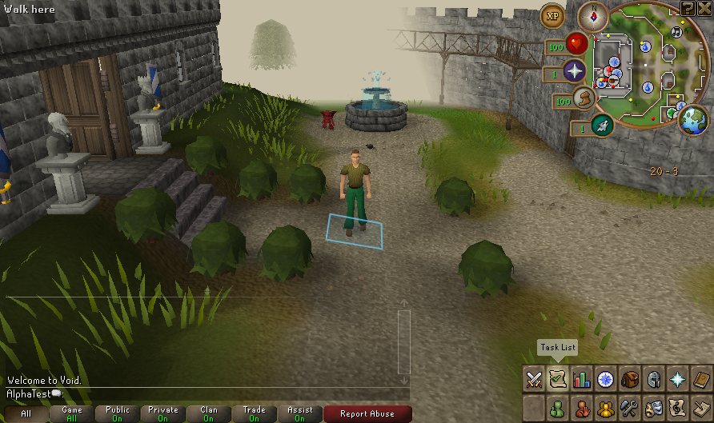

# Native 52/56 test build — 18 October 2026

A fresh private snapshot from implementation commit
`3f534e765782f03845508755ced0e6c674966cd0` is ready with server patch **52** and
client patch **56**. It includes the [permanent Slayer block and recovery fixes](SLAYER_TASK_BLOCKS_20261018.md)
alongside the earlier native grave/death corrections. All **10,907** listed snapshot
entries verify after the native session, and **48** relevant packaged classes match
the tested compiler outputs. Source exports match 105 server/140 client files.

Local build: `.runtime/deck-exports/1792279981977972530`. Run
`bash scripts/deck-launch.sh` from that directory on a suitable desktop; the script
selects its copied Java runtimes. This payload contains separately supplied assets
and must remain private. Owner Deck deployment, save transfer and public release
remain held. The [51/56 report](NATIVE_TEST_BUILD_51_20261017.md) stays historical.

## Copied-build acceptance

A fresh original AlphaTest profile passed New, confirmed in-game Save & Quit and
Continue. The first quit press required confirmation. Normal shutdown saved the
world; a later cancellation during loading preserved the entire saved world.
All **five** generated fixture backups independently validate.

| Host observation | New | Continue |
| --- | ---: | ---: |
| Complete session including readiness dwell and saving | 23.321 s | 23.878 s |
| Peak sampled server RSS | 1,539,408 KiB | 1,290,872 KiB |
| Peak sampled client RSS | 1,204,772 KiB | 1,539,804 KiB |
| Peak simultaneous sampled JVM RSS | 2,434,704 KiB | 2,816,456 KiB |

RSS is sampled every 0.5 seconds across cold JVM/cache work, readiness and shutdown.
The simultaneous peak comes from the same sample, not the sum of independent peaks.
These figures are not startup-only timings, steady-state memory, Deck FPS, power
measurements or a performance comparison. This uses owned Xvfb/software rendering,
a private HOME and per-profile client configuration, with an empty ALSA setup and
no audio. The separate 53-case Slayer suite validates the repaired contracts; this
smoke validates ordinary exported-session lifecycle, not a graphical Slayer journey.

[Sanitized manifest, package, lifecycle, resource and screenshot evidence](evidence/native-test-build-52-20261018.json).
Server SHA-256: `c547232a12f7ddb4b452cb8c5227c38c253634b9a7af575be2485dbe44d77021`.
Client jar bytes remain unchanged. Experimental Backport Lab mappings/cache overlays,
WASM and prototype grave records are not enabled in this build.

Physical acceptance should include block/unblock navigation, task assignment and
Save & Quit/Continue using the controller. Gaming Mode, audio, sustained performance
and suspend remain open. Unrecovered grave/floor persistence across restart remains
a separate P1 and is not implemented by this change.
