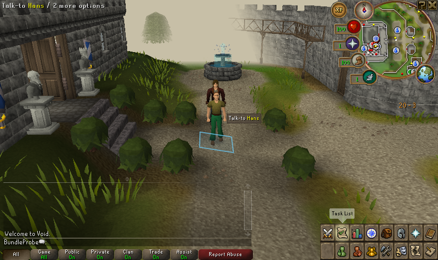

# Prebuilt native New/Continue — 17 October 2026

The matched native client and server complete real New/Continue sessions from a read-only jar/data payload with no source, Git metadata or Gradle files inside their working directories. They use an external private server-cache copy, profile-owned client cache and new disposable account. This extends the [empty-server closure experiment](PREBUILT_NATIVE_SERVER_20261017.md). The graphical launcher still requires source-build preflight; receiving/applying a managed package remains separate work.

| Observed host result | Value |
| --- | ---: |
| New complete session | 23.917 s |
| Continue complete session | 22.764 s |
| Verified before/after backups | 4 |
| Server runtime data | 3843 files / 8,530,252 bytes |
| Supplied server cache copied privately | 39 files |
| Account name, XP, inventories and tile after Continue | equal |
| Read-only payload and both server-cache inventories | unchanged |

Each session requires native world readiness, verified server capabilities, normal client completion, the fresh exact native primary-save receipt and verified post-stop backup. The 56-client/42-server matched jars stay unchanged; the existing original smoke instrumentation compiles separately and runs through a classpath. No inventory is supplied or character teleported by this probe.

These are total session durations including startup, asset transfer, client readiness dwell and save/closure. They are not frame times or Deck FPS. This was private Xvfb/software rendering with **audio explicitly excluded**, not physical controller/Gaming Mode acceptance. The first attempt reached New but the next client stalled in `DirectAudioDeviceProvider.nNewDirectAudioDeviceInfo`; its thread dump and failed report are retained. The coordinator sent SIGTERM only to the verified fixture client and let the owned server finish normal save hooks. A tiny separate audio probe found enumeration completes with host runtime context or with an empty ALSA configuration. The accepted run uses the latter (zero mixers); audible audio remains a package gate.

[Sanitized evidence](evidence/prebuilt-native-session-20261017.json) pins jars, source inputs, runner and per-round outcomes. [Reproduction and boundaries](../experiments/native-prebuilt-session/README.md). Private successful report: `.runtime/prebuilt-session/1792262812432617514/summary.json`; failed audio run: `.runtime/prebuilt-session/1792262655843901485/summary.json`.

Preparation uses source/Git/JDK tools, then bypasses the source-build doctor for this controlled runner. The checkout remains mounted, so this is not a filesystem sandbox or proof from a clean machine. Build/recovery context is still the coordinator's original source context; instrumented sessions do not establish orphan recovery. No owner accounts, installation or saves are scanned; no proprietary cache, art or binaries are committed.

Next prove an explicit prebuilt runtime manifest/preflight against the same payload, preserving original-version locks and all external-state contracts. Then exercise the actual launcher and interrupted/refused startup on disposable state. Public dependency/distribution review, complete world persistence (including graves), stopped-world apply/rollback and physical acceptance remain open.
