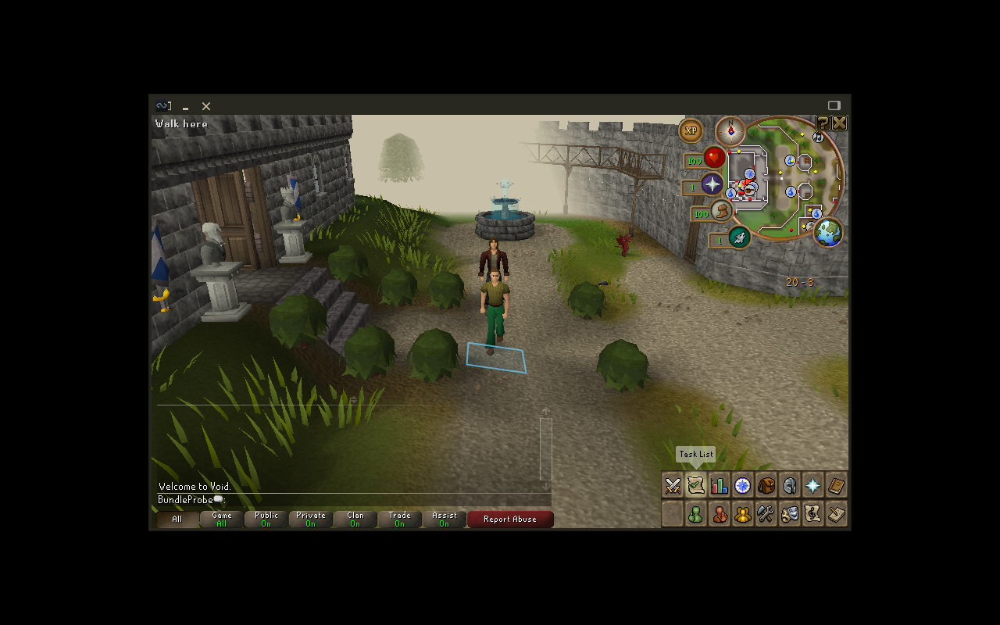

# Private native version-change lifecycle — 17 October 2026

A copied profile now passes an actual two-version native launch, orphan recovery, Continue and code-rollback experiment. The older version uses server patch stack 42; the newer uses stack 45. Both use client 56. These changes introduce no save-format migration, so this proves compatibility of these specific builds, not arbitrary downgrades.

## What ran

The private driver copies two prepared immutable payloads, the authorized local cache and the earlier BundleProbe fixture into a fresh ignored lab directory. External profile, cache and launcher locations are shared; version-owned build/recovery contexts remain distinct. The original fixture, both source payloads and input cache inventories remain unchanged. Runtime payloads contain no native Java/Kotlin source, Git or Gradle layout; their Python application code remains present. Existing local Java21/Java8 runtimes are supplied separately.

Real launcher stdio backends start the native server and raw `java -jar` client. A forwarding wrapper adds only a private temporary directory and preserves the native argv, environment and inherited lock descriptors. No NativeSessionSmoke classpath, reflection, fabricated packets or direct save edits drive the game.

1. A starts and logs the fixture account into the native server. While A runs, B tries the same profile on a different free port. The actual profile lock refuses B after preflight, preserving A's journal, backups and process identities.
2. The probe SIGKILLs only A's verified Python backend. Both native JVMs survive. B refuses recovery because its build-lock identity differs; archive also refuses on the still-held profile lock. The original journal and children remain unchanged.
3. A new backend from A's original code root verifies both process guards and recovers normally through pidfd SIGTERM. It records one `after-recovered-shutdown` backup, with the correct recovered session. Its message explicitly says clean shutdown is unconfirmed. Compared account fields remain equal.
4. B continues. The raw client initially displays its native graphics setup prompt; the coordinator chooses Leave Alone on the private Xvfb display, reviews the resulting world screenshot and clicks ground through standard AWT Robot input. The real saved tile changes from **3221,3219 to 3222,3217**. Account name, XP and inventory remain equal.
5. A continues the same current profile generation and stops normally. All compared post-B fields, including the new tile, survive. No backup restore or generation switch occurs.

Ten backups validate: the four initial snapshots plus three pre-launch, one recovered and two clean-shutdown snapshots. Both copied payloads, cache and original fixture inputs remain unchanged; all owned backends/JVMs and the private display close after the probe.

## Evidence and remaining gates

The [sanitized evidence](evidence/prebuilt-version-lifecycle-20261017.json) records exact build/manifest/tool hashes and checks. Private run `1792268000442259956` retains the full trace, screenshots, input acknowledgement and logs. An earlier attempt stopped on an overly narrow archive-error wording assertion; guarded original-context cleanup closed its processes. The assertion was corrected to expect the actual profile-lock refusal. An initial helper-import failure occurred before any game process started. Failed evidence is retained separately.

The successful run took roughly 74 seconds including copying, three native launches, screenshots, explicit coordinator input waits and shutdowns. That is a workflow observation, **not** an FPS, startup benchmark or Deck performance result. Software rendering and an empty private ALSA configuration exclude audible audio. Mouse input is synthetic on an owned display; no physical controller, Steam Gaming Mode or suspend acceptance is claimed.

No downloader, installed-version pointer, trusted outer updater, public package, fresh-machine installation or owner deployment was implemented. Whole-world update preservation remains blocked by [unpersisted grave/floor state](GRAVE_PAUSE_PERSISTENCE_PLAN.md). Release publication and owner Deck installation stay held. The next packaging stage can use this evidence to design stopped-world activation, while preserving the original context for any unresolved session.
