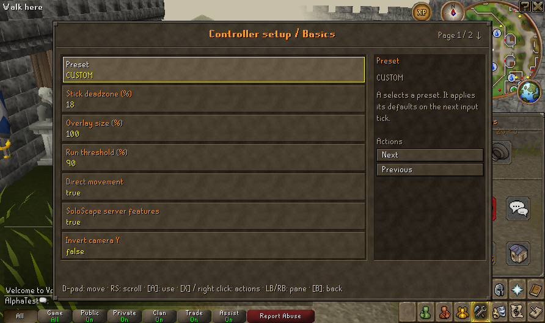

# Settings save follow-up — 17 October 2026

Current native **51/56** passes strict Settings/New/Continue/save checks with default preferences and with both direct movement/server features explicitly enabled in a disposable fixture. Each run preserves account identity, XP, inventories and tile **3221,3219** exactly; startup cancellation preserves the saved world. This does not explain or fix the historical [r30 Deck one-tile observation](DECK_CONTROLLER_VALIDATION_20261014.md). Its cause remains open, and that dated evidence is unchanged.

## Coverage improvement

The first current run's reviewed native screenshot showed both movement options disabled. That is a valid compatibility default, but it left the direct-configured case untested. New `--settings-direct` implies `--settings` before conflict checks and supplies an explicit test-only JVM flag. The harness sets the two preferences only in the disposable profile's private client home. Product defaults, game jars and owner preferences are unchanged.

Both direct-configured sessions must show actual Settings adoption, B ancestry, same-client relog, a fresh capability nonce, both preference flags enabled, verified server capabilities and the mode still enabled after relog. Python rejects missing/false required results. Verification has a bounded wait. The virtual pad remains neutral; this checks configuration/UI/lifecycle boundaries, not held-direction movement or actual directional-packet emission.

The direct fixture observed both flags false before its first override and true before its Continue override. The flags were true during both Settings checks and after each relog. The existing deadzone, keyboard and theme preference change/reversal checks also pass. Source inspection confirms `profile_session.py` passes each original fixture's private `client-home` explicitly with `-Duser.home`; no owner configuration comparison or access was needed.

| Complete host session, including readiness/UI/relog/save | New | Continue |
| --- | ---: | ---: |
| Default preferences | 44.289 s | 43.396 s |
| Direct-configured fixture | 44.623 s | 42.676 s |

These are session totals, not FPS or a performance comparison. All ten fixture backups validate. Four character-bearing backups in each run retain identical hashes for all four tested fields. All listed snapshot entries still verify after the runs: 10,888 in the existing native 51 export and 10,896 in the new tooling export. Root tooling passes 276 cases with one existing optional skip; the external Java 8 harness compiles and runs against unchanged jars.

Claude Haiku reviewed the small fixture change and reported no actionable defect. Coordinator review added the bounded verification wait and final mode assertion, then ran the real New/Continue check. [Sanitized results, field hashes, inputs and limits](evidence/settings-save-followup-20261017.json).

## Reproduce and follow up

After normal matched native setup, create a fresh private export with `python3 scripts/deck_export.py`. In that export, configure its local JDK selectors with `python3 scripts/deck_runtime.py --configure`, then run `bash scripts/smoke-profile.sh --settings-direct`. Use `--settings` for the default-preference case. The qualified direct run is under `.runtime/deck-exports/1792277175967392705/.runtime/alpha-tests/session-1792277246080889729/`; the initial default run is under the existing 51 export at `session-1792276745745594012`.

Both runs used owned Xvfb/software displays, original AlphaTest worlds, private homes and an empty ALSA configuration. No physical controller, Deck/Gaming Mode, audio or suspend acceptance follows. Existing input samples occur at tile changes and do not exclude transient input between samples. Logout-stage `8,8` trace values are not saved-world tile assertions. If the old Deck difference recurs, retain the current build, input method and phase evidence; do not weaken the strict comparison or infer save corruption from the old observation. No extra repeat campaign or speculative input rewrite is justified by this passing host result.

The four-field comparison is not whole-game persistence acceptance; [unrecovered grave/floor restart persistence](GRAVE_PAUSE_PERSISTENCE_PLAN.md) remains a separate P1.
