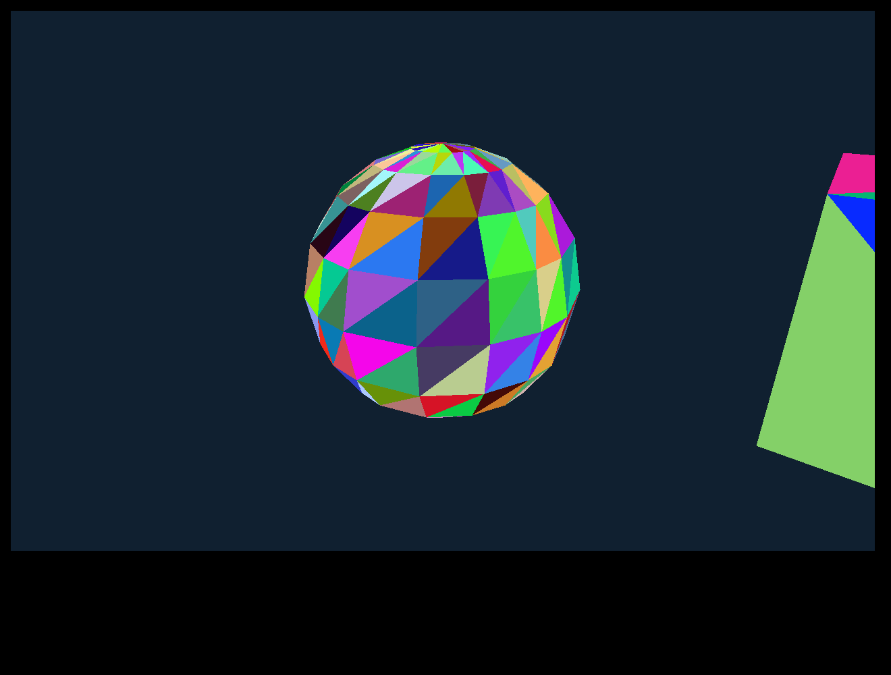

# WASM face proof: native projection and flat-face dispatch — 17 October 2026

Status: **the flat projected-face path passes on all three runtimes.** `Class64_Sub1.method654` (`i == -1`) → `method650` → `method643` → `method635` → `Class109.method1018` produces identical projected x/y/depth integer arrays, colour hashes and depth hashes on the native jar bytecode, the extracted source on JDK 21 and TeaVM 0.16.0 WasmGC in headless Chromium, for ten cases at 765×503 and 1280×800. This follows the [source audit](WASM_FACE_BOUNDARY_AUDIT_20261017.md), which this run checked rather than assumed, and builds on the [flat fill](WASM_RENDERER_INVESTIGATION.md) and [material fills](WASM_MATERIAL_INVESTIGATION.md). It is a small original closed mesh, not a model, a scene or a performance result.



Code: [experiments/wasm-face](../experiments/wasm-face/README.md). Evidence: [wasm-face-20261017.json](evidence/wasm-face-20261017.json) (inputs, toolchain and closure digests, per-case hashes, vertex controls; full projected arrays for the two 765×503 baseline cameras, while the checker compared all ten cases element for element).

## What ran

One original scene: a 154-vertex, 300-face closed mesh (a latitude/longitude sphere and a cube partly outside the right edge so the x-clip flag is set), built with rational circle parametrisation and integer rounding only (no trig, so every runtime derives the same vertices). Faces are untextured and take a **precomputed original palette index per face** (`anIntArray5368`, `anIntArray5366 == -1`) mapped through an original 65,536-entry synthetic palette in `Class126`. No cache, `Class124` decoding, lighting, animation, texture or near-plane clipping is involved.

Each runtime sets the same fields of an un-constructed `Class64_Sub1` (vertex and face arrays, state 2, the camera and view transforms, viewport fields) and calls `method654(camera, null, -1, 0)`:

1. **Native reference:** the real jar bytecode, `ha_Sub1`, `Class167`, `Class64_Sub1`, `Class101_Sub1` allocated with `sun.misc.Unsafe`, private fields set and `method654` invoked by reflection. The native `method657`, `method646`, `method658`, `method3724` and `Class109` run unmodified.
2. **JVM extracted:** the same source closure compiled with `javac` and no jar on the classpath.
3. **WasmGC:** the identical closure through TeaVM 0.16.0, run in headless Chromium (private CDP pipe, loopback server).

Ten cases per runtime (sizes 765×503 and 1280×800 × five): camera 0 (the model matrix equals the identity test, the fast path), camera 1 (a rotated model matrix, the general matrix product path), and for camera 0 two further adapter variants and one perturbed vertex. Transform entries use exact rational constants (3/5, 4/5, 5/13, 12/13), so no runtime computes a trig value. The two cameras' unit scales were chosen to give sensible depths, **not** to claim the native scale conventions.

## Exact source closure

| Item | Count | Treatment |
| --- | --- | --- |
| `Class64_Sub1` methods | 9: `method654` (266), `method650` (34), `method643` (45), `method635` (21), `method634` (7), `method632` (24), `method655` (36), `method629` (4), `method638` (4) | **441 verbatim lines** (budget 450) |
| Native instance fields kept | **59** (budget 65) | Declarations verbatim except the `private` modifier removed so the harness can set them; `extends Class64` dropped |
| `Class109` | field block, constructor, `method1018` → `method1026`, `method1023` | Verbatim (512 method lines) |
| `method657` | replaced | **Hand-written guarded adapter, 10 lines (budget 20), NOT verbatim** |
| Glue | constructor and `harnessProject` (2 lines) | Hand-written |
| Stubs (count and throw) | `method646`, `method658`, `ha_Sub1.method3720`, `Class109.method1022/1024`, `ha.method3645` | Hand-written bodies, native signatures |
| Type stand-ins | `ha_Sub1`, `Class167`, `Class101`, `Class101_Sub1`, `Class126` (palette), `Class6`, `Class350`, `Class318_Sub3`, `Class129`, `Class342` | Generated, only the members the bodies name |

The adapter keeps `method634`'s signature and body verbatim: `method634` still calls `method657` unconditionally. The adapter counts each entry, **throws on any state other than 2**, and applies exactly the native state-2 effects: `aShortArray5311 = null` when `(anInt5316 & 0x97098) == 0 && aFloatArrayArray5314 == null`, and `aByteArray5386 = null` when the flag argument is true. The state-0 colour pass (`method636`, `method649`, `method647` and ~340 further lines) is excluded. Its two effect lines are a hand-written adapter in `experiments/wasm-face/tools/extract_face_closure.py`, not extracted text.

**Excluded paths:** near-plane clipping (`method646`), lit faces (`method658`), textures (`method1022/1024/1020`, `method3720`), the colour pass, `Class124` decoding, lighting, animation, translucency (`aByteArray5325` is null), the multi-thread lock (`anInt7485 == 1`), `Class318_Sub3` tracking (null) and wireframe.

The extractor aborts on any change to the nine-method set, more than 450 verbatim lines, more than 65 fields, an unaudited callee, class or static member. `javac -Xlint:all` compiles the closure with no jar on the classpath with no errors and no warnings.

## Correctness

For every case the native jar, the extracted JVM and WasmGC agree on:

- the **projected `anIntArray5321` (x), `anIntArray5343` (y) and `anIntArray5355` (depth) arrays, element for element** (154 values each);
- covered pixel count, distinct colour count, colour FNV-1a and depth FNV-1a of the framebuffer;
- front and back face counts, the adapter's post-call `aShortArray5311`/`aByteArray5386` state, and the case metadata.

| Case | Size | Front / back faces | Covered pixels | Colour FNV-1a | Depth FNV-1a |
| --- | --- | --- | --- | --- | --- |
| camera 0 | 765×503 | 122 / 178 | 83,414 | `927a0c71` | `b8767a57` |
| camera 1 | 765×503 | 111 / 189 | 66,801 | `1afdcb0a` | `aefc1bdc` |
| camera 0 | 1280×800 | 123 / 177 | 221,695 | `8fcb49ca` | `31a85d6d` |
| camera 1 | 1280×800 | 113 / 187 | 184,091 | `d5e3c626` | `6818a2a9` |

Camera 0's adapter variants (mask bit set, `aFloatArrayArray5314` non-null) leave `aShortArray5311` in place on all three runtimes and give the same frame; the default clears it.

**Face-dispatch derivation.** Front and back faces are recomputed from the projected arrays with long arithmetic (the signed screen area `> 0`), independently of the implementation. The harness then re-renders the framebuffer by calling `Class109.method1018` directly on exactly those front faces in index order and requires its colour and depth hashes to equal the full `method650`/`method643`/`method635` output. This detects changed *visible* output. **Native exception counts are not available** (the jar is not instrumented) and `method650` swallows exceptions, so on the native side the equality does not prove that no exception was swallowed, only that any swallowed exception did not change the frame; no native zero-exception claim is made. On the extracted builds the counters additionally require exactly one adapter entry, zero illegal adapter hits and zero stub hits for every case. Every case draws 111–123 front faces and has 177–189 back faces.

**Anti-bypass control: culling changes the frame.** A closed opaque mesh could in principle look identical with or without culling because depth testing hides rear faces. So each case also renders the same projected triangles with **all** faces (no culling) straight through the flat fill, and then restores the front-only frame. These all-faces hashes agree across the native jar, JVM and WasmGC, and at both sizes both canonical cameras differ from the front-only frame (colour and depth hashes; coverage is equal):

| Case | Front-only colour | All faces colour | Front-only depth | All faces depth |
| --- | --- | --- | --- | --- |
| camera 0, 765×503 | `927a0c71` | `415084e5` | `b8767a57` | `d066589f` |
| camera 1, 765×503 | `1afdcb0a` | `64dcfd75` | `aefc1bdc` | `b8e5ce82` |
| camera 0, 1280×800 | `8fcb49ca` | `43306fd0` | `31a85d6d` | `99808d54` |
| camera 1, 1280×800 | `d5e3c626` | `5c12ea09` | `6818a2a9` | `c7232608` |

The existing geometry already differed, so no sentinel triangle was added. The checker requires at least one canonical case per size to differ (mutation `culling-equal` rejects equal hashes). The reason the rear faces change the frame was not investigated; only that they do.

**Vertex control (demonstrably visible).** Moving original vertex 17 by +50 world units in x changes the *native* projection (x 450 → 462 at 765×503, 748 → 767 at 1280×800) and both framebuffer hashes, with no other vertex, y or depth change. A one-ULP matrix change was not used because it can vanish in the integer conversion.

**Presentation.** The 1280×800 camera 1 frame, put on a canvas by `putImageData`, reads back with the hash of the words handed to it and matches the native frame hash.

## Negative controls (each exits nonzero)

| Control | How | Rejected by |
| --- | --- | --- |
| Perturbed vertex in **one implementation** | `FACE_SELFTEST=jvm-vertex` (extracted JVM) and `browser-vertex` (WasmGC, `?perturb=1`) | checker: `projX differs from the native jar reference` |
| Illegal adapter state | `illegal-state0` (state 0) | adapter throws `method657 adapter supports state 2 only: 0` |
| Illegal stubs | `illegal-texture` (`method1024`), `illegal-lit` (`method658`), `illegal-clip` (`method646`) | stub counters nonzero: `stub reached {...}` |
| Altered browser colour hash / one projected element | `browser-hash`, `browser-element` | checker |
| Missing browser output, duplicate case, missing presentation hash fields | `missing-browser`, `duplicate-case`, `missing-present` | checker (presentation hashes must be present, valid hex and equal; `wholeMatrixMs` finite positive) |
| Zero coverage, no back faces, equal control, fake culling (all-faces == front-only) | `zero-coverage`, `no-backface`, `control-equal`, `culling-equal` | checker |
| Stub or adapter counter | `counter-stub`, `counter-adapter` | checker |

All seventeen corruption cases exit 1; the clean run exits 0. Missing, relative or wrong inputs, a non-21 JDK and a changed jar or source digest are refused with a message before any build.

## Inputs, toolchain, commands

Jar `ac6e2671…6a918` (full digest in the evidence), `Class64_Sub1.java` `e0251870…a91398`, `Class109.java` `058b9ffd…74308a`; all ten audited source digests are in `inputsSha256`. OpenJDK 21.0.12.1, TeaVM 0.16.0, Chromium 153.0.8010.52, Node 26.11.1. No dependency was added or upgraded and no native Gradle build ran. `face.wasm` 113,200 bytes raw, runtime JS 17,268 bytes (digests in the evidence).

The final run used the coordinator-frozen read-only copy of the same jar (`.runtime/wasm-face-inputs-20261017/void-client.jar`, SHA-256 verified identical):

```bash
U=/home/kannibalkiwi/orca/projects/SoloScape/upstream/runelite-client
JAVA_HOME=/home/kannibalkiwi/orca/projects/SoloScape/.runtime/jdks/jdk21 UPSTREAM_GRADLEW=$U/gradlew \
  bash experiments/wasm-face/run.sh $U/client/src \
  /home/kannibalkiwi/orca/projects/SoloScape/.runtime/wasm-face-inputs-20261017/void-client.jar
```

The whole ten-case matrix (render plus hashing) took about 0.27–0.50 s in headless Chromium across several runs (0.50 s in the committed evidence) on an uncontrolled desktop host; this is **not a frame time, not a device result and not a performance claim**.

## Limits

- Only the flat, in-front, untextured, opaque path: no clipping, lighting, textures, animation, translucency, model decode, real palette, cache or scene.
- The adapter is hand-written and state 2 only; its equivalence is checked on the two fields it touches, for three variants, on all three runtimes; other states are refused.
- The reference uses `Unsafe`, reflection and set-up values chosen for this scene (camera scales, viewport fields); the harness proves the closure computes what the jar computes for those inputs, not that the inputs match a real frame.
- Native counters are unavailable (no jar instrumentation): on the native side the direct-fill equality detects changed visible output, not every possible swallowed exception; the extracted builds additionally use counters.
- 32-bit FNV hashes plus full projected arrays: a hidden framebuffer difference is unlikely, not impossible. Float behaviour matched on these inputs only.
- Headless host Chromium only. No Deck, Chromebook, display or frame-pacing evidence.

## Decision

The audit's stop conditions did not trigger. The face path is small enough (441 + 10 lines, 59 fields) to carry, but it covers one flat branch of one model class. Adding clipping (`method646`, 133 lines), lit faces (`method658`, 67 lines), textures or a real colour pass each widens the closure and needs its own gate; none is started.

## Coordinator verification

An independent clean run reproduces all ten projected-array/framebuffer cases,
including adapter side effects and culling sensitivity. [Coordinator evidence](evidence/wasm-face-20261017-coordinator.json)
records the exact module/source identities and 18 rejected negative checks: all
11 checker mutations, an actually missing browser output file, four illegal JVM
branches and actual perturbed-vertex JVM/browser runs. The clean output was
preserved after those checks. Its whole-matrix time is about 0.475 seconds on an
uncontrolled host; native validation also ran on this machine, so this is not a
performance comparison. The module is 113,200 bytes raw and 43,606 bytes gzip,
plus 17,268 bytes of runtime JavaScript, excluding the user-supplied native inputs.

The screenshot was inspected and contains only the original synthetic scene.
No native model, cache, jar, generated native source or Wasm module is committed.
