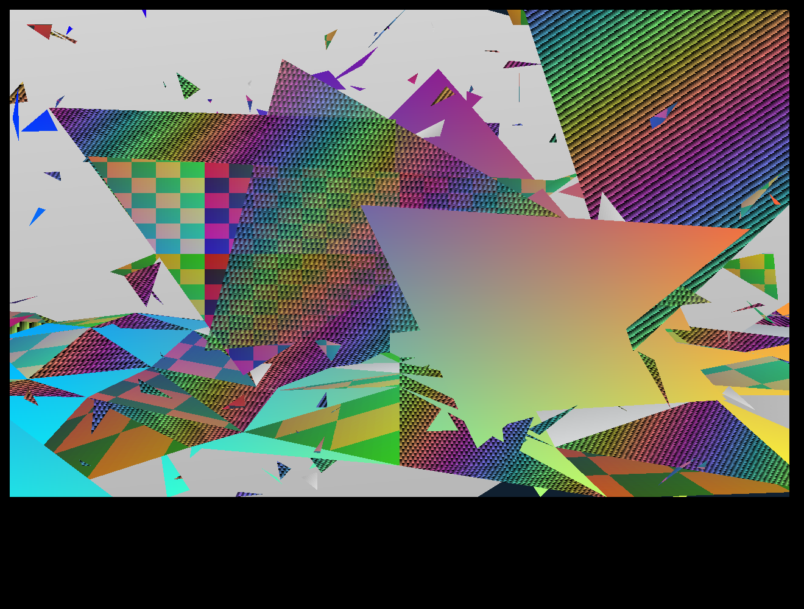

# WASM material investigation: native shaded and textured triangle fills

Status: **the raster-fill gate passes for all four non-flat Class109 triangle fills; everything above the fill is still unproven.** The real native `method1022` (palette-shaded), `method1027` (RGB Gouraud), `method1024` (single texture) and `method1020` (three-layer texture) compile through TeaVM 0.16.0 WasmGC as a **closure of eight `Class109` methods (3,868 of 4,467 lines) plus `Class6.method206`**, with three generated stand-ins. Five original scenes at 765×503 and 1280×800 produce identical colour and depth-buffer hashes on the native jar bytecode, the extracted source on the JVM and WasmGC in headless Chromium. This builds on the [flat-colour result](WASM_RENDERER_INVESTIGATION.md).

Code: [experiments/wasm-material](../experiments/wasm-material/README.md). Evidence: [wasm-material-20261017.json](evidence/wasm-material-20261017.json) (final run, with toolchain and closure block) and [the first run](evidence/wasm-material-20261017-first-run.json).

## Closure audit (what the real methods depend on)

Roots `method1022`, `method1027`, `method1020`, `method1024`; the extractor follows `methodNNNN(` calls inside `Class109` and audits every outside reference.

| Method | Role (verified by reading the source and by output) | Reaches |
| --- | --- | --- |
| `method1022` | palette-shaded: three per-vertex palette indices interpolated per pixel, depth tested, blend `anInt1674` | `method1019` (span), wireframe `ha.method3645`, `Class126.anIntArray4983` |
| `method1027` | Gouraud: three per-vertex RGB words | `method1021` (span), `ha.method3645` |
| `method1024` | one texture, perspective-correct u/v, per-vertex tint and fog | `method1016` (span), `method1027` (null-texture fallback), `Class6.method206`, texture provider |
| `method1020` | three texture layers blended by barycentric weights, per-layer scale | `method1025` (span), `method1027` (fallback), `Class6.method206`, texture provider |

Audited outside dependencies, **each with its treatment** (the extractor aborts naming any other member; `closure.json` records the list):

| Dependency | Used for | Treatment |
| --- | --- | --- |
| `ha_Sub1.anInt7477`, `anIntArray7483`, `aFloatArray7511` | stride, pixels, depth (constructor) | generated stand-in fields |
| `ha_Sub1.anInt7501` | default texture size (128) | stand-in field |
| `ha_Sub1.method3718/3719` | texel array for a texture id (two native caches) | stand-in returning original synthetic texels, `null` for an unloaded id |
| `ha_Sub1.method3726/3727/3714` | texture mode (0/1/2), small-texture flag, wrap flag | stand-in over `SynthAssets` |
| `ha.method3645` | wireframe line, only when the wireframe flag is set | stub that throws; **unreachable**: the flag is never set |
| `Class167.aBoolean2202` | depth test enabled | generated stand-in, `true` |
| `Class126.anIntArray4983` | HSL palette | stand-in holder filled with an **original synthetic 65,536-entry palette**; the native builder (`Class239_Sub25.method1827`, `Math.random` jitter) is excluded |
| `Class6.method206` | colour blend in the fallback | **verbatim**; only dependency is its own static counter `anInt152` |

Signatures of the replaced `ha_Sub1`/`ha` members are checked against the native source; a change aborts the run. `javac -Xlint:all` compiles the closure with no jar on the classpath (130-odd lossy float-to-int lint warnings from the verbatim native code, 0 errors), so no hidden dependency exists. **Not extracted** from `Class109`: `method1017`, `method1018` (flat fill, previous gate), `method1023` (sets the wireframe flag), `method1026` (flat span), `method1028`.

This closure did **not** pull in a large renderer surface: the texture dependency is five tiny accessors on `ha_Sub1`, and everything the texture cache normally does (decoding, mip/blur) sits behind them.

**Excluded, and the consequence:** wireframe lines; the real texture cache and material decoding (`ha_Sub1.aClass60_7498`, `d`, `Class12`, `Class348_Sub25`, including its 3×3 box blur for non-alpha-test materials, so the browser sees whatever the stand-in supplies); real palette generation; vertex transform, projection and the face loop in `Class64_Sub1`/`s_Sub1` that decides which fill to call and derives the arguments (UV, fog, tint, weights); lighting; `Class167` threading; the AWT presenter, sprite and UI paths. Each needs its own audit.

## Inputs and digests

Source and jar SHA-256 for every audited file are in the evidence JSON (`inputsSha256`); generated-source, wasm, runtime JS and every committed experiment file digest are in `toolchain`. Key values: `client/src/Class109.java` `058b9ffd…74308a`, `Class6.java` `824995b6…f8c1f77e`, `Class126.java` `32e88d03…89a39`, jar `ac6e2671ed548c73ad4dcaf8e4446789f29c2780236059de12e6132795a6f918`, `material.wasm` `0bb29e2e670a2b69cbe49b6ad35a07c5ecd1e26ef4b7c3d3fc6c5c1e4969e8ed`. Toolchain: OpenJDK 21.0.12.1, TeaVM 0.16.0, Chromium 153.0.8010.52, Node 26.11.1.

Nothing native is committed. The generated `Class109.java` and `Class6.java` keep the native JODE header and a provenance banner with the source SHA-256 and live only in the ignored `experiments/wasm-material/build/`. No Jagex asset is read or shipped: the palette and textures are original integer-arithmetic patterns. The licence status of the native source is not analysed and no legal conclusion is drawn.

## Correctness

Three implementations run the identical scene through a `Fill` seam that sets only what the native callers set (blend, x-clip flag, vertex data, texture ids):

1. the **real jar bytecode**, with `ha_Sub1`/`Class167` allocated via `Unsafe` and the jar's own texture-cache code (`ReferenceCache`, `Class348_Sub25`, `method3718/3719/3726/3727/3714`) fed the same synthetic texels through a stub material source, so the jar's provider logic is exercised and not just replaced;
2. the extracted source on JDK 21;
3. the same source in TeaVM WasmGC, headless Chromium.

For every case triangle count, null-texture-fallback count, covered pixels, **distinct colour count, colour FNV-1a and depth FNV-1a (bit patterns)** match across all three; the validator accepts no tolerance. Shaded and Gouraud share a depth hash (same geometry), as expected.

| Scene | Size | Pixels covered | Distinct colours | Colour FNV-1a | Depth FNV-1a |
| --- | --- | --- | --- | --- | --- |
| shaded | 765×503 | 380,049 | 51,013 | `dd4fb87f` | `9ada52e7` |
| gouraud | 765×503 | 380,049 | 51,338 | `081dcc01` | `9ada52e7` |
| tex1 | 765×503 | 377,861 | 59,720 | `4d9a14b2` | `2797c522` |
| tex3 | 765×503 | 380,049 | 165,245 | `2b9122d0` | `0290e90c` |
| mixed | 765×503 | 380,049 | 57,744 | `940b8970` | `2fdbf9f6` |
| shaded | 1280×800 | 1,020,698 | 75,145 | `af7fae8c` | `10f34170` |
| gouraud | 1280×800 | 1,020,698 | 67,751 | `c0bf9201` | `10f34170` |
| tex1 | 1280×800 | 1,012,579 | 74,692 | `9aadeea5` | `c7117523` |
| tex3 | 1280×800 | 1,020,697 | 275,992 | `3bb354c7` | `8f6ee621` |
| mixed | 1280×800 | 1,020,698 | 102,130 | `7cbc2928` | `45b94a9b` |

(Hashes print without leading zeros in the evidence JSON.) Each scene is 980 triangles. They exercise depth overlap, clipping on all four edges (x-clip flag derived as native callers do), translucency (64, 128), fog tint, three-layer blending, texture modes 0/1/2 (opaque, alpha-test, alpha-channel), and the null-texture fallback (`tex1`/`tex3`: 98 triangles, `mixed`: 65), which runs `method1027` with `Class6.method206` colours.

**Anti-stand-in checks.** A flat fill cannot pass these, and each is enforced and self-tested:
- **Palette/texel controls:** re-rendering `shaded`, `tex1` and `tex3` with a perturbed palette or perturbed texels must change the pixels, identically on all three runtimes (all six size/control cases do: e.g. `tex1` 765×503 `4d9a14b2` → `a9fb8636`). The validator rejects equal hashes ("the fill is not sampling it").
- **Distinct-colour floors** per scene (10,000; 50,000 for `tex3`) reject flat-looking output (`flat-standin` mutation).
- **Fallback coverage** is required in the textured scenes.

Presentation: the canvas readback hash of the mixed frame after `putImageData` equals the hash of the RGBA words handed to it at both sizes. Alpha is forced opaque in the adapter.

**Negative controls on the harness (all rejected, `MATERIAL_SELFTEST_MUTATE`):** altered browser hash, missing browser result, zero raster timing, NaN timing, duplicated browser case, flat-fill stand-in, equal control hash. Missing, duplicate, non-finite or inconsistent evidence fails closed.

## Measurements (real clock, repeated samples)

TeaVM WasmGC, headless Chromium 153, Intel i7-14700HX, software canvas, uncontrolled power/thermal/other load, `performance.now()` with no virtual time (0.1 ms quantisation). Raster = triangle submissions plus context bind excluded; 3 warm-up frames then 15 samples per case. **Two complete runs are reported because they differ by up to 2×** (other host load was not controlled); run 2 is the final evidence file and the JVM columns come from it.

| Scene | Size | WasmGC median ms, run 1 / run 2 | JVM extracted | JVM native jar |
| --- | --- | --- | --- | --- |
| shaded | 765×503 | 3.0 / 5.8 | 1.6 | 3.3 |
| gouraud | 765×503 | 2.9 / 10.4 | 1.6 | 1.8 |
| tex1 | 765×503 | 13.6 / 25.9 | 7.4 | 8.0 |
| tex3 | 765×503 | 28.7 / 42.4 | 17.5 | 20.3 |
| mixed | 765×503 | 4.0 / 5.6 | 2.1 | 2.2 |
| shaded | 1280×800 | 5.0 / 7.1 | 4.3 | 4.4 |
| gouraud | 1280×800 | 5.6 / 7.9 | 4.4 | 4.8 |
| tex1 | 1280×800 | 32.6 / 40.9 | 17.8 | 17.8 |
| tex3 | 1280×800 | 83.2 / 82.0 | 42.8 | 46.5 |
| mixed | 1280×800 | 10.0 / 11.1 | 5.5 | 6.2 |

Reading: WasmGC is roughly 1.5–2× slower than warm HotSpot on the textured fills in these runs and about equal on shaded/Gouraud at 1280×800 in run 1. The cause was not investigated. The scenes cover about 98% of the frame with 980 triangles, so `tex1` at 1280×800 (about 33–41 ms) and especially the three-layer `tex3` (about 80 ms) are heavy-fill figures on a desktop CPU, **over a 16.7 ms frame budget when a frame is full-screen textured**; typical scenes cover less and mix fill kinds (`mixed`: 10–11 ms). This says nothing about a real scene, Deck or Chromebook. Module payload: `material.wasm` 107,234 bytes raw, 39,826 gzip -9; TeaVM runtime JS 17,268 bytes.

## Gates

| Gate | Outcome |
| --- | --- |
| Code boundary | **Pass for the four fills.** 8 methods, one verbatim helper, three stand-ins; named exclusions above; no large renderer surface pulled in. |
| Correctness | **Pass** against the real jar bytecode at both sizes for shaded, Gouraud, textured (single and three-layer), alpha modes and the fallback, with palette/texel controls proving the content is sampled. |
| Performance | **Measured, not a verdict.** Full-screen textured fills are expensive; unmeasured: realistic coverage, scene logic, devices. |
| Distribution | No native source, jar bytes or Jagex asset committed; original synthetic assets; TeaVM 0.16.0 Apache-2.0. Full notice inventory still outstanding. |
| Reversibility | Remove `experiments/wasm-material/`, this report and the evidence. No native source, patch, jar or profile touched. |

## Limits (unproven)

- Texels are original; real material decoding, the native texture cache blur and real HSL palette are not exercised in the browser.
- The call arguments are synthetic. Native geometry set-up (`Class64_Sub1`, `s_Sub1`) that produces UV, fog, tint and weights is a separate audit; so are lighting, animation and a model/region decode.
- The reference harness uses `sun.misc.Unsafe` and reflection; browser code does not.
- 32-bit FNV hashes plus distinct counts make a hidden difference unlikely, not impossible. Full framebuffer dumps were not compared.
- Float-to-int behaviour matched on these inputs on JVM and WasmGC; other inputs are not proven.
- Headless host Chromium only: no real display, frame pacing, memory, cold start, Deck or Chromebook.

## Next step (not started)

Audit the smallest face loop that feeds these fills from projected vertices (`Class64_Sub1` model path) and decide whether that boundary is small or pulls in the whole model class; stop there. A broad `Class64_Sub1`/`ha_Sub1` port is a different decision.
