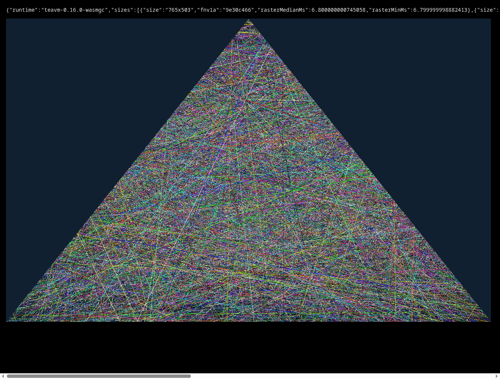

# WASM raster proof: one native face-edge kernel through TeaVM WasmGC

Status: **bounded attempt complete; partial pass.** One real 634 software-raster kernel (`ha_Sub1.method3636`) compiles through a narrow closure into TeaVM 0.16.0 WasmGC. Its framebuffer hashes match the JVM bytecode from the client jar at 765×503 and 1280×800 in headless Chromium. Presentation through a per-pixel JavaScript conversion dominates the frame.

**UNPROVEN:** the triangle, model and full-raster gate. The kernel is a masked line/edge stepper, not a triangle fill. The 3D triangle filler was not isolated, no model or full scene was rendered, and no device budget was measured. Code: [experiments/wasm-raster](../experiments/wasm-raster/README.md). Plan: [WASM_SPIKE_PLAN](WASM_SPIKE_PLAN.md).

## Inputs and digests

| Input | SHA-256 |
| --- | --- |
| `upstream/.../client/src/ha_Sub1.java` (read only, local) | `f3f01437c28ad160ca356311ab021d9d4cfbc4759cb367435f0209eba4b0bae7` |
| `upstream/.../client/build/libs/void-client-0.2.0_a2.jar` (read only, local) | `ac6e2671ed548c73ad4dcaf8e4446789f29c2780236059de12e6132795a6f918` |
| Generated `raster.wasm` (TeaVM 0.16.0, not committed) | `0adfe5df745ef5df4c822a0b49eec43206de4b5f330e0dbf6fed991a02ab6d96` |

Nothing from the native source or jar is committed. The extractor writes the method body to the ignored `experiments/wasm-raster/build/`. The licence status of the native source is not analysed here, and no legal conclusion is drawn.

## Dependency audit: where the native raster code sits

- **Kernel chosen:** `ha_Sub1.method3636`, 129 lines. It draws one edge across a per-row span mask into `anIntArray7483`, with clip fields `anInt7476`, `anInt7477`, `anInt7496`, `anInt7503`, `anInt7507`, and mask arrays `aa_Sub3.anIntArray5201`/`5202`. Its only external references are `java.lang.Math` and `IllegalArgumentException`. `SceneEntity` (lines 121–122) calls it on the face path. The sibling `Class75` uses `method3674`, which is not in this closure. It is a line-and-span stepper, not a triangle fill.
- **Closure result:** the generated class compiles on JDK 21 with no jar on the classpath, so the closure is those six fields plus two stubs. Compiling it alone surfaced no other dependency.
- **Excluded native paths:**
  - The framebuffer and presentation path (`Class348_Sub31_Sub1`) uses AWT `DataBufferInt`, `DirectColorModel`, `BufferedImage` and `Graphics.drawImage`. It is replaced by a Canvas `ImageData` adapter. The native `Canvas` and `Class167` per-thread context are also left out.
  - `ObjType.method1568`, reached from `Class49.method14/15`, is a framebuffer copy, not a rasteriser.
  - `Class105_Sub3_Sub1.method994` is a 2,956-line sprite blitter.
  - I did not isolate the 3D triangle filler that draws models. A closure audit of that path is a separate gate.

## Results

Hashes are identical across every run. FNV-1a is over 32-bit framebuffer words.

| Run | 765×503 FNV-1a | 1280×800 FNV-1a | Match |
| --- | --- | --- | --- |
| JVM native jar bytecode (`ha_Sub1.method3636`) | `9e30c466` | `f22bb6bd` | reference |
| JVM generated verbatim kernel | `9e30c466` | `f22bb6bd` | yes |
| TeaVM WasmGC in headless Chromium 153 (reviewed real-clock run) | `9e30c466` | `f22bb6bd` | yes |

A screenshot of the browser run shows the triangular mask clipping the edges, with opaque, blended and additive edges visible.

Measured costs from the coordinator's reviewed real-clock run: TeaVM WasmGC, headless Chromium 153.0.8010.52, Intel i7-14700HX host. The original virtual-time captures were unsuitable for timing: an independent rerun returned **zero** for all browser durations. Those durations are superseded here. The wrapper now uses a private CDP pipe, waits for completion without virtual time and rejects zero raster timings. [Machine-readable result](evidence/wasm-raster-20261017.json).

| Size | Raster median per frame | Wasm→JS conversion, one frame | `putImageData` |
| --- | --- | --- | --- |
| 765×503 | 6.8 ms | 13.8 ms | 1.2 ms |
| 1280×800 | 12.2 ms | 27.7 ms | 2.0 ms |

Raster is the median of six frames after one warm-up; presentation is sampled once. Conversion crosses into JavaScript once per pixel. The combined micro-scene cost is roughly 22/42 ms at these sizes, so this presentation method does not meet a 60 FPS budget on the host. Power/thermal state was uncontrolled; startup, frame tails, heap, full-scene rendering and Deck/Chromebook performance were not measured.

Module payload: `raster.wasm` 40,442 bytes raw, 21,223 bytes with `gzip -9`. The TeaVM runtime JS is 17,268 bytes (6,130 gzip). The JVM verbatim run is not a browser benchmark: its medians (6–14 ms) vary between runs.

## Plan gates

| Gate | Outcome |
| --- | --- |
| Code boundary | **Pass for this kernel.** Closure is six fields and two stubs. The AWT presenter and the triangle filler are not covered. |
| Correctness | **Pass for hashes.** JVM jar bytecode, JVM verbatim and WasmGC match at both sizes. Integer-only scene, so no tolerance was needed. |
| Performance | **Measured, not a pass.** Real-clock raster ~7–12 ms; per-pixel JS conversion ~14–28 ms. A buffer view or a WebGL texture upload was not tried. |
| Distribution | Nothing native committed. Dependencies: `org.teavm:teavm-jso:0.16.0` only, with the TeaVM Apache-2.0 note from the kernel experiment; a full inventory is still needed. |
| Reversibility | No native source, patch, jar or profile is changed. Removing `experiments/wasm-raster/` and this doc reverts the work. |

## Limitations

- One kernel is not a triangle filler and not a 3D scene. An original triangle mask only exercises clipping and edge stepping.
- The hash is a 32-bit FNV-1a, not a cryptographic digest. Matching hashes on this scene make a bit-exact difference unlikely but do not rule it out.
- Published timings use real-clock headless Chromium. Earlier virtual-time durations were rejected; these host measurements still do not establish frame pacing on a real display.
- The native reference is reflective and is used only for correctness. It allocates `ha_Sub1` and `aa_Sub3` with `sun.misc.Unsafe.allocateInstance`, bypassing their constructors. That is the only use of `Unsafe`, it is not in the browser build, and it is not extended.
- `ha_Sub1` was not constructed. The native constructor needs a live Canvas and renderer state, so only the raster method is exercised.
- No login, server, cache, world simulation or physical device was used.

## Next gate, not started

Separately approved follow-up options: (a) measure a WebAssembly-memory view or WebGL texture upload to remove the per-pixel conversion, and (b) isolate the 3D triangle filler on the model path, which is a larger closure audit. Neither is implemented here.
