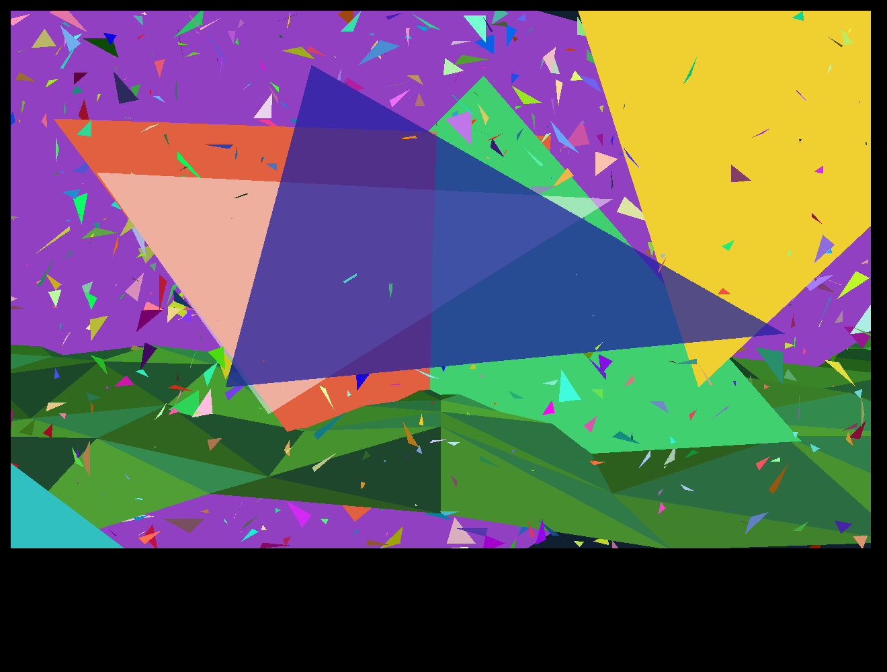

# WASM renderer investigation: the native flat-colour triangle fill

Status: **gate 1 and gate 2 pass for the flat-colour triangle fill; the rest of the model renderer is unproven.** The real native triangle fill from `Class109` compiles through TeaVM 0.16.0 WasmGC with a closure of **two methods plus the constructor**. An original single triangle and an original 2,180-triangle mesh produce identical colour and depth-buffer hashes on the native jar bytecode, the extracted source on the JVM, and WasmGC in headless Chromium at 765×503 and 1280×800.

**Update 2026-10-17:** the shaded, Gouraud and textured fills (`method1022/1027/1024/1020`) now also pass at both sizes, see [WASM_MATERIAL_INVESTIGATION](WASM_MATERIAL_INVESTIGATION.md). **UNPROVEN:** wireframe triangles, vertex transform/projection, model decoding, animation, colour palette and any real model or scene. Code: [experiments/wasm-triangle](../experiments/wasm-triangle/README.md). Machine-readable result: [evidence/wasm-triangle-20261017.json](evidence/wasm-triangle-20261017.json). Earlier work: [WASM_RASTER_POC](WASM_RASTER_POC.md) (masked edges only), [WASM_SPIKE_PLAN](WASM_SPIKE_PLAN.md), [WASM_FEASIBILITY](WASM_FEASIBILITY.md).

## The actual triangle path (source-backed)

`Class167` holds the per-thread raster state: `Class167.aClass109_2220` is a `Class109`, created by `Class167.method1292` and its constructor. `Class109` (4,467 lines) is the software triangle rasteriser. Its `ha_Sub1` owner sets the clip rectangle and a row-offset table in `ha_Sub1.method3713` (`anInt1679` = clip width, `anInt1672` = clip height, `anIntArray1676[y] = y * stride`).

Model call sites (`Class64_Sub1`, the software model class that holds `aClass109_5383 = class167.aClass109_2220`):

| Native method | What it draws | Call sites (file:line) |
| --- | --- | --- |
| `Class109.method1018` | flat colour, depth tested | `Class64_Sub1.java:371` (inside `method635`), `:1993`, `:2010`, `:2011` |
| `method1022`, `method1027` | probably per-vertex shaded (12 floats, or 9 floats plus 3 ints; the colour meaning is inferred from the signature, not verified) | `Class64_Sub1.java:373, :1994, :2013, :2014`, `:2882..2917` |
| `method1020`, `method1024` | textured (15 floats plus 8 ints; inferred from the signature and the texture-array fields in the span helpers, not audited) | `Class64_Sub1.java:379, :381, :2000..2025, :2890..2925` |
| `method1023` | sets the wireframe flag from a render-flag bit | `Class64_Sub1.java:2488` |

`Class64_Sub1.method635` is the flat-colour model path: it takes three vertex indices, reads screen x/y/depth from `anIntArray5321/5343/5355`, sets `aClass109_5383.anInt1674` (translucency) from a per-face array, and calls `method1018` with the colour from `Class126.anIntArray4983[face & 0xffff]`. The same fill is also reached from `ha_Sub1.java:1766/1768` and `s_Sub1.java:576..1481` (terrain). The full call-site list is in `build/closure.json` after a run.

The extractor follows `methodNNNN(` calls inside `Class109` from `method1018`. The graph is:

- `method1018` → `method1026` (span fill, `private final`). `method1018` has a second branch, active only when `aBoolean1675` (wireframe) is set, that calls `ha.method3645` → an abstract line drawer. That branch is excluded (see below).
- `method1026` calls nothing else.

**Closure (everything compiled for the browser):**

| Piece | Source | Treatment |
| --- | --- | --- |
| `Class109` field block (34 fields), constructor, `method1018`, `method1026` | `Class109.java` | verbatim, 509 extracted method lines; no static initialiser exists in this class |
| `ha_Sub1` | `anInt7477` (stride), `anIntArray7483` (pixels), `aFloatArray7511` (depth); the constructor reads these three | generated stand-in with those three fields |
| `ha.method3645` (wireframe) | `ha.java:110` | stub that throws `UnsupportedOperationException`; **unreachable in the scenes** because the wireframe flag is never set |
| `Class167` | `aBoolean2202` (depth test on) | generated stand-in with that one field; set `true` |
| Harness | original | `Fill` interface, scene, hashing, canvas adapter |

No other native class is referenced. `javac -Xlint:all` compiles the closure with no jar on the classpath, which is the audit: there is no hidden dependency to stub. 11 other `Class109` methods are not in the closure (`method1016`, `1017`, `1019`–`1025`, `1027`, `1028`).

**Excluded and their consequence:** wireframe lines (`method3645`); textured fill (`method1020/1021/1024/1025`) and texture/material state; per-vertex shading (`method1022`, `method1027`); vertex transformation, projection and face culling in `Class64_Sub1`; the HSL palette (`Class126.anIntArray4983`, built in `Class239_Sub25.method1827` with `Math.random()` jitter, so even native colours are not bit-reproducible); `Class167` threading; `ha_Sub1` setup, canvas and the AWT presenter; the sprite and UI paths. Any of these would need its own closure audit.

## Inputs and digests (read only, local)

| Input | SHA-256 |
| --- | --- |
| `client/src/Class109.java` | `058b9ffd636007796f75dd50f25a422e173e820f7dcee135b6b71989d874308a` |
| `client/src/Class167.java` | `d76c65b840aaca9bf042581c68c6e5c4b5bcd037f00c19a72f82edacbd1a5975` |
| `client/src/ha_Sub1.java` | `f3f01437c28ad160ca356311ab021d9d4cfbc4759cb367435f0209eba4b0bae7` |
| `client/src/ha.java` | `f50efd45125feb64dfee81a3dcbe6b25324550b1a8d5701f6121d0b91a8d2a6b` |
| `client/src/Class64_Sub1.java` | `e02518708ff51fc07c42e1f3fa587810c40c715948054c344b90484afda91398` |
| `client/build/libs/void-client-0.2.0_a2.jar` | see the evidence JSON (`inputsSha256.client_jar`) |

Nothing from the native source or jar is committed; the extractor writes the bodies into the ignored `experiments/wasm-triangle/build/`. The licence status of the native source is not analysed and no legal conclusion is drawn. The generated file keeps the native JODE header and gets a provenance banner.

## Correctness

Three implementations run the identical original scene through a `Fill` seam that only sets what the native callers set (translucency, x-clip flag, three-vertex y/x/depth, colour):

1. the real `Class109` bytecode in the native jar (reflection; `ha_Sub1`/`Class167` allocated with `Unsafe`, constructors skipped; correctness reference only);
2. the extracted source on JDK 21;
3. the same source in TeaVM WasmGC, headless Chromium 153.

For every case the triangle count, covered pixels, **colour-buffer FNV-1a and depth-buffer FNV-1a (bit patterns)** match across all three. Floating-point set-up and per-pixel depth interpolation are in play. All recorded colour/depth hashes agree; no tolerance is accepted by the validator. Full framebuffer byte dumps were not compared, so the 32-bit hash limitation below still applies.

| Scene | Size | Triangles | Pixels drawn | Colour FNV-1a | Depth FNV-1a |
| --- | --- | --- | --- | --- | --- |
| single | 765×503 | 1 | 75,046 | `71213147` | `d33d455a` |
| single | 1280×800 | 1 | 199,679 | `06b70375` | `f8b3b900` |
| single64 | 765×503 | 64 | 75,046 | `a2493229` | `d7cb455a` |
| single64 | 1280×800 | 64 | 199,679 | `c7ca24b2` | `5bd2b900` |
| mesh | 765×503 | 2,180 | 379,741 | `b0e3d579` | `de7c96c0` |
| mesh | 1280×800 | 2,180 | 1,020,572 | `979c0db8` | `8bf41420` |

What the mesh genuinely exercises, all inside the extracted closure: **depth test and overlap** (two large triangles whose depth planes cross, and 1,500 random-depth small triangles), **clipping** (triangles past all four edges, using the x-clip flag as the native callers derive it and the y clipping inside `method1018`), and **translucency** (blend weights 64, 128 and the special 254 mode). One-off checks, not committed: with the depth test off the 765×503 mesh hash changes (`b0e3d579` → `c5741a2a`), and with the x-clip flag forced false the fill reads outside the buffer (`ArrayIndexOutOfBoundsException`). So both are really exercised. Native callers must therefore supply that flag correctly; this closure does not protect them.

The canvas readback hash after `putImageData` equals the hash of the RGBA words handed to it, so presentation does not alter pixels. Alpha is forced opaque in the adapter (the native blend arithmetic does not preserve a meaningful alpha byte).

## Measurements (real clock, repeated samples)

TeaVM WasmGC, headless Chromium 153.0.8010.52, Intel i7-14700HX host, software canvas, uncontrolled power/thermal state, `performance.now()` with no virtual time (Chromium quantises it to 0.1 ms). Raster = triangle submissions only; the buffer clear and context bind are timed separately. 3 warm-up frames, then 15 samples per case; a second full run reproduced the medians within about 10%.

| Scene | Size | WasmGC raster median (min–p90) | JVM extracted median | JVM native jar median | Clear (median) |
| --- | --- | --- | --- | --- | --- |
| single (1 tri) | 765×503 | 0.1 ms (below timer step) | 0.07 ms | 0.15 ms | 1.3 ms |
| single64 | 765×503 | 7.4 ms (6.9–7.9) | 3.5 ms | 3.4 ms | 0.5 ms |
| mesh | 765×503 | 2.4 ms (2.3–2.5) | 2.3 ms | 2.7 ms | 0.5 ms |
| single (1 tri) | 1280×800 | 0.3 ms (0.2–0.4) | 0.23 ms | 0.26 ms | 1.1 ms |
| single64 | 1280×800 | 14.4 ms (13.9–14.8) | 13.1 ms | 14.1 ms | 1.1 ms |
| mesh | 1280×800 | 4.1 ms (4.1–4.2) | 5.4 ms | 5.7 ms | 1.0 ms |

The JVM columns are warm in-process medians, not browser benchmarks, and vary between runs. WasmGC is in the same range as the HotSpot JIT on the mesh, about 2× slower on the 64-fill 765×503 case (the cause was not investigated). The mesh covers about 98% of the frame, so it is a heavy fill case but not a realistic scene.

Presentation, separate from raster (median of 7 samples, one frame of the mesh):

| Size | Per-pixel JS call (old method) | Wasm-side RGBA swizzle + bulk `Int32Array.set(int[])` | `putImageData` call |
| --- | --- | --- | --- |
| 765×503 | 6.9 ms | 1.8 ms | 0.1 ms |
| 1280×800 | 19.7 ms | 4.6 ms | 0.2 ms |

The bulk path removes most of the per-pixel conversion cost seen in the raster PoC, but it is still a copy of every pixel. `putImageData` returns quickly in headless software canvas and probably defers the real upload, so its figure is not a display cost. Mesh raster plus bulk presentation is about 4.2 ms at 765×503 and 8.7 ms at 1280×800 on this host, which leaves room inside 16.7 ms for this fill alone but says nothing about a full scene, UI, startup, heap or the Deck/Chromebook.

Module payload: `triangle.wasm` 57,528 bytes raw, 25,859 gzip -9 (hash in the evidence JSON); TeaVM runtime JS 17,268 bytes (6,091 gzip).

## Gates

| Gate | Outcome |
| --- | --- |
| Code boundary | **Pass for flat-colour fill.** Two methods, the constructor and two stand-in types; wireframe branch stubbed and unreachable. Not a statement about the rest of `Class64_Sub1`. |
| Correctness | **Pass.** Colour and depth hashes identical across native jar, JVM extracted and WasmGC at both sizes, with clipping, overlap, depth and translucency exercised. |
| Performance | **Measured, not a verdict.** Fill-only costs fit a frame budget on this host; scene content, UI, texture/shaded paths and devices are unmeasured. |
| Distribution | No native source, jar bytes or assets committed. Dependency: `org.teavm:teavm-jso:0.16.0` (Apache-2.0). A full dependency/notice inventory is still outstanding. |
| Reversibility | Remove `experiments/wasm-triangle/` and this doc and evidence. No native source, patch, jar or profile is touched. |

## Limits

- This is the cheapest of four triangle fills. The textured fill (`method1020/1021/1024/1025`) pulls in texture/material state, and shaded fills use three-colour interpolation; their closures were not audited beyond signatures and call sites.
- Original synthetic geometry only. Real models need cache decoding, vertex transform, projection and the face loop in `Class64_Sub1`, each of which is a separate closure audit.
- The reference harness uses `sun.misc.Unsafe.allocateInstance` against the jar; it is not in the browser build.
- 32-bit FNV hashes are not cryptographic; equal colour and depth hashes across three runtimes make a hidden difference unlikely, not impossible.
- Host headless Chromium only, no display, real frame pacing, memory, cold-start, Deck or Chromebook measurement. No login, server, cache decoding or whole-client port was attempted.

## Next step

The shaded and textured closures are audited and pass ([material report](WASM_MATERIAL_INVESTIGATION.md)). Next: the smallest face loop in `Class64_Sub1` that feeds `method1018` from projected vertices. Stop at the same boundary: a broad `Class64_Sub1` or `ha_Sub1` port is a different decision.

## Coordinator verification

An independent clean experiment run reproduced all six scene/size cases against the real jar, extracted JVM and browser. Missing results, altered browser hashes and zero mesh timings were each rejected. Browser duplicate cases and non-finite raster/clear timings are also rejected. The original worker evidence is retained, with this additional run appended. See the separate [pixel-transfer comparison](WASM_TRANSFER_INVESTIGATION.md) for the reusable direct-NIO and primitive-array options; neither result establishes a full game scene.
